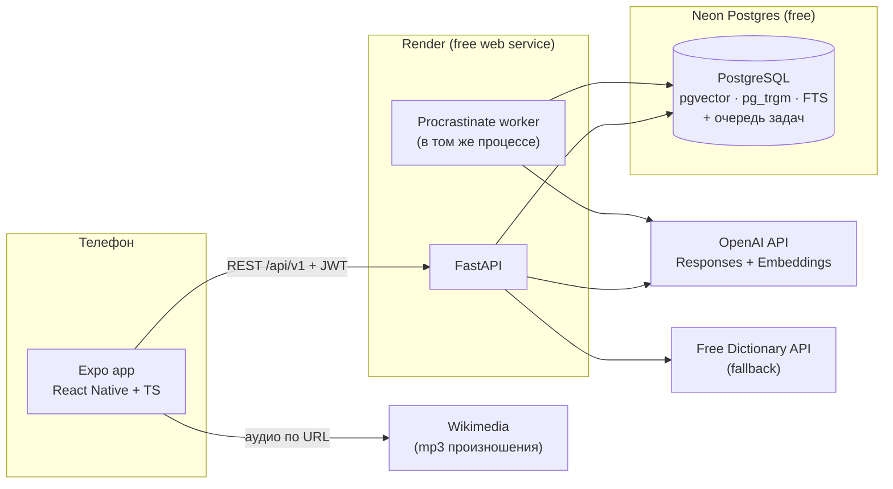

# Архитектура

> Продукт — [PRODUCT.md](PRODUCT.md). Почему выбрано именно так — [DECISIONS.md](DECISIONS.md).
> Этот документ описывает **как устроена система**. Если код расходится с документом, сначала
> обсуждается и обновляется документ, потом код.

## 1. Общая схема



- **Модульный монолит.** Один backend-сервис, одна база. Микросервисов нет.
- **PostgreSQL — единственное хранилище:** данные, лексикон, векторы, полнотекстовый поиск,
  очередь фоновых задач, лимиты. Redis нет.
- Backend — источник истины для всех долгоживущих данных. На устройстве только токен, настройки
  читалки и кэш TanStack Query.

## 2. Репозиторий

```text
language_app/
├── CLAUDE.md                 # правила для агента (общие)
├── .claude/                  # skills, agents, hooks, settings
├── backend/                  # FastAPI, Python 3.13, uv
│   ├── CLAUDE.md
│   ├── app/
│   ├── alembic/
│   ├── tests/
│   ├── evals/                # eval-наборы и раннер AI-функций
│   ├── scripts/              # импорт лексикона, демо-книг, неправильных глаголов
│   └── pyproject.toml
├── mobile/                   # Expo (React Native), TypeScript, FSD
│   ├── CLAUDE.md
│   ├── app/                  # маршруты Expo Router (тонкие файлы)
│   └── src/                  # FSD-слои
├── infra/
│   ├── docker-compose.yml    # локальный Postgres с pgvector
│   └── render.yaml           # Render Blueprint
├── docs/
│   ├── PRODUCT.md  ARCHITECTURE.md  DECISIONS.md  backlog.md
│   ├── plan/                 # фазы и задачи для Claude Code
│   └── evals/                # отчёты прогонов eval
└── .github/workflows/        # CI
```

## 3. Стек

### Backend

| Область | Выбор |
| --- | --- |
| Язык и пакеты | Python 3.13, `uv` (`pyproject.toml` + `uv.lock`) |
| Web | FastAPI, Pydantic v2, pydantic-settings |
| БД | PostgreSQL 17, SQLAlchemy 2.x async + `psycopg` 3 (один драйвер и для ORM, и для Procrastinate), Alembic |
| Расширения БД | `vector` (pgvector), `pg_trgm`, встроенный FTS (`tsvector`) |
| Фоновые задачи | Procrastinate (очередь в PostgreSQL), воркер в процессе API |
| NLP | spaCy `en_core_web_sm` — лемматизация, части речи, деление на предложения |
| Парсинг книг | `ebooklib` (EPUB), `defusedxml` + `lxml` (FB2, XHTML), `selectolax` (HTML → текст), `charset-normalizer` (TXT) |
| AI | OpenAI Python SDK: Responses API со structured outputs, Embeddings (`text-embedding-3-small`, 512 измерений). Имя модели — только из настроек |
| HTTP-клиент | `httpx` с таймаутами |
| Логи | `structlog`, JSON, correlation ID |
| Качество | `ruff` (lint + format, PEP 8), `mypy --strict`, `pytest`, `pytest-asyncio` |

### Mobile

| Область | Выбор |
| --- | --- |
| Платформа | Expo (последний SDK, который поддерживает Expo Go), React Native, TypeScript strict |
| Навигация | Expo Router (маршруты в `mobile/app/`) |
| Архитектура | Feature-Sliced Design в `mobile/src/` |
| Серверное состояние | TanStack Query |
| Клиентское состояние | Zustand (сессия обучения, выделение фразы, настройки читалки) |
| API | `openapi-typescript` (типы из OpenAPI FastAPI) + `openapi-fetch` |
| Формы | `react-hook-form` + `zod` |
| Списки | `@shopify/flash-list` |
| Нижние панели | `@gorhom/bottom-sheet` (на `react-native-reanimated` + `react-native-gesture-handler`) |
| Нативное | `expo-secure-store`, `expo-document-picker`, `expo-audio`, `expo-crypto`, `expo-application` |
| Стили | `StyleSheet` + дизайн-токены в `shared/ui/theme` |
| Тесты | `jest-expo`, `@testing-library/react-native` |
| Линт | ESLint (flat config) + Prettier + `steiger` (линтер FSD) |

**Жёсткое ограничение:** только библиотеки, работающие в Expo Go (см. DECISIONS ADR-002).

## 4. Backend: модули

```text
backend/app/
├── main.py                  # create_app(): middleware, роутеры, обработчики ошибок, lifespan
├── api.py                   # сборка APIRouter /api/v1
├── core/                    # инфраструктура без бизнес-смысла
│   ├── config.py            # Settings (pydantic-settings)
│   ├── database.py          # engine, async session, Base
│   ├── security.py          # JWT, хэширование секретов
│   ├── errors.py            # AppError и маппинг в HTTP
│   ├── logging.py           # structlog, correlation ID
│   ├── jobs.py              # Procrastinate App, запуск воркера в lifespan
│   └── rate_limit.py        # лимит частоты запросов (in-memory, один инстанс)
├── modules/
│   ├── auth/                # вход по устройству, текущий пользователь
│   ├── users/               # профиль, onboarding, удаление аккаунта
│   ├── languages/
│   ├── lexicon/             # Lexeme, LexemeForm, Meaning, Translation, MeaningContent, lookup
│   ├── vocabulary/          # UserVocabularyItem, формы для подсветки
│   ├── collections/
│   ├── enrichment/          # подготовка карточки (задача + сервис)
│   ├── books/               # загрузка, парсинг, главы, абзацы, прогресс чтения
│   ├── book_qa/             # чанки, индексация, гибридный поиск, ответы (RAG)
│   ├── study/               # сессии и упражнения
│   ├── irregular_verbs/
│   ├── usage/               # суточные лимиты AI и загрузок
│   └── events/              # продуктовая аналитика
└── integrations/
    ├── ai/                  # AIProvider protocol, OpenAI, промпты по фичам с версиями
    ├── embeddings/          # EmbeddingProvider protocol, OpenAI
    ├── dictionary/          # FreeDictionaryProvider (fallback)
    └── nlp/                 # обёртка spaCy: lemmatize_in_context, split_sentences
```

Типовой модуль: `router.py`, `schemas.py`, `models.py`, `repository.py`, `service.py`,
`exceptions.py`, `dependencies.py`, `jobs.py` — **только те файлы, которые нужны**.
Слои и направление зависимостей:

```text
router (HTTP) → service (use cases, транзакции) → repository (SQL) → models
                      ↘ integrations (через Protocol)
jobs (Procrastinate) → service
```

Правила слоёв — в `backend/CLAUDE.md`.

## 5. Модель данных

Типы: `uuid` — для сущностей пользователя, `bigint` — для общих справочных данных.
Все таблицы имеют `created_at`; изменяемые — `updated_at`.

### 5.1. Пользователь

| Таблица | Поля | Ограничения |
| --- | --- | --- |
| `user` | `id uuid`, `native_language_id`, `learning_language_id`, `cefr_level`, `answer_language` (`en_simple`\|`ru`), `onboarding_completed_at?` | |
| `auth_identity` | `id`, `user_id`, `provider` (`device`), `external_id`, `secret_hash?` | unique (`provider`, `external_id`) |
| `daily_usage` | `user_id`, `day date`, `kind` (`ai_lookup`, `book_question`, `book_upload`), `count` | PK (`user_id`, `day`, `kind`) |
| `product_event` | `id`, `user_id?`, `name`, `payload jsonb` | индекс (`name`, `created_at`) |

### 5.2. Лексикон (общие данные)

| Таблица | Поля | Ограничения и индексы |
| --- | --- | --- |
| `language` | `id`, `code`, `name` | unique `code` |
| `lexeme` | `id`, `language_id`, `text`, `normalized_text`, `type` (`word`\|`phrase`), `ipa?`, `audio_url?`, `frequency_rank?`, `source` (`wiktionary`\|`free_dictionary`\|`ai`) | unique (`language_id`, `normalized_text`); GIN trgm на `normalized_text` |
| `lexeme_form` | `id`, `lexeme_id`, `form_normalized`, `tags text[]` | unique (`lexeme_id`, `form_normalized`); индекс `form_normalized` |
| `meaning` | `id`, `lexeme_id`, `part_of_speech`, `gloss` (короткое англ. описание из словаря), `sense_order`, `source`, `source_external_id?` | индекс (`lexeme_id`, `sense_order`) |
| `translation` | `id`, `meaning_id`, `language_id`, `text`, `source` (`wiktionary`\|`ai`) | unique (`meaning_id`, `language_id`, `text`) |
| `meaning_content` | `id`, `meaning_id`, `cefr_level`, `definition?`, `example?`, `status`, `provider`, `model`, `prompt_version`, `generated_at?` | unique (`meaning_id`, `cefr_level`, `prompt_version`) |
| `sense_selection` | `id`, `lexeme_id`, `context_hash`, `selected_meaning_id?`, `contextual_translation?`, `confidence`, `model`, `prompt_version` | unique (`lexeme_id`, `context_hash`, `prompt_version`) |
| `irregular_verb` | `id`, `base_lexeme_id`, `past_simple`, `past_participle`, `*_audio_url?`, `translation` | unique `base_lexeme_id` |

`sense_selection` хранит только **хэш** предложения, но не сам текст: кэш общий, а текст книги личный.

### 5.3. Словарь пользователя

| Таблица | Поля | Ограничения |
| --- | --- | --- |
| `user_vocabulary_item` | `id uuid`, `user_id`, `meaning_id`, `source_type` (`manual`\|`book`), `book_id?` (SET NULL), `paragraph_id?` (SET NULL), `source_context?` (≤ 500), `context_translation?`, `personal_note?`, `meaning_content_id?`, `enrichment_status`, `study_count`, `last_studied_at?` | unique (`user_id`, `meaning_id`) |
| `collection` | `id uuid`, `user_id?`, `name`, `description?`, `is_system` | unique (`user_id`, `name`) |
| `collection_item` | `collection_id`, `user_vocabulary_item_id` | PK пары |

`enrichment_status`: `pending` → `enriching` → `ready` \| `partial` \| `failed`.

### 5.4. Книги

| Таблица | Поля | Ограничения и индексы |
| --- | --- | --- |
| `book` | `id uuid`, `owner_user_id?` (NULL = демо-книга), `title`, `author?`, `format` (`epub`\|`fb2`\|`txt`), `status` (`uploaded`\|`parsing`\|`indexing`\|`ready`\|`failed`), `error_code?`, `file_sha256`, `chapter_count`, `paragraph_count`, `word_count` | unique (`owner_user_id`, `file_sha256`) |
| `book_upload` | `book_id`, `content bytea` | временно, удаляется после парсинга |
| `book_chapter` | `id`, `book_id`, `chapter_index`, `title` | unique (`book_id`, `chapter_index`) |
| `book_paragraph` | `id bigint`, `book_id`, `chapter_id`, `position` (сквозной номер в книге), `text`, `sentence_spans int[]` (пары start/end) | unique (`book_id`, `position`) |
| `reading_progress` | `user_id`, `book_id`, `paragraph_position` | PK (`user_id`, `book_id`) |
| `book_chunk` | `id bigint`, `book_id`, `chapter_id`, `start_position`, `end_position`, `text`, `embedding vector(512)`, `search_vector tsvector` (generated, `english`) | HNSW (`embedding vector_cosine_ops`); GIN (`search_vector`); индекс (`book_id`, `end_position`) |
| `book_question` | `id uuid`, `user_id`, `book_id`, `question`, `answer`, `answer_language`, `reading_position`, `cited_chunk_ids bigint[]`, `found_in_text`, `model`, `prompt_version`, `input_tokens`, `output_tokens` | индекс (`user_id`, `book_id`, `created_at`) |

### 5.5. Обучение

| Таблица | Поля |
| --- | --- |
| `study_session` | `id uuid`, `user_id`, `collection_id?`, `kind` (`vocabulary`\|`irregular_verbs`), `status` (`active`\|`completed`\|`abandoned`), `current_stage`, `stage_state jsonb`, `started_at`, `completed_at?` |
| `study_session_item` | `session_id`, `user_vocabulary_item_id?`, `irregular_verb_id?`, `position` |

У пользователя не больше одной активной сессии (частичный unique-индекс по `user_id` при `status = 'active'`).

## 6. Пайплайны

### 6.1. Импорт лексикона (один раз, локально)

```text
kaikki.org English JSONL ──► scripts/import_lexicon.py
   1. оставить lang_code = "en" и леммы из частотного списка (top N, по умолчанию 60 000)
   2. lexeme: слово, IPA (первая US/UK), mp3_url произношения
   3. lexeme_form: формы (went → go, books → book) из поля forms / form_of
   4. meaning: senses → gloss, part of speech, порядок; не больше 8 значений на часть речи
   5. translation: переводы на русский, привязанные к sense, если есть
   6. фразы (phrasal verbs, idioms) из того же дампа — type = phrase
   └► upsert батчами, идемпотентно (повторный запуск не дублирует)
```

Запускается с машины разработчика против Neon (`DATABASE_URL`), не на Render: там 512 МБ памяти.
Отчёт импорта: сколько лемм, доля значений с русским переводом, размер таблиц. Цель — лексикон
не больше 300 МБ. Атрибуция Wiktionary (CC BY-SA) — на экране «О приложении».

### 6.2. Lookup слова

Вход — одна из двух форм (discriminated union по `source`):

- `manual`: `{text, context_sentence?}`;
- `book`: `{book_id, paragraph_id, char_start, char_end}`. Сервер сам берёт текст абзаца и
  предложение — клиенту не доверяем и не гоняем текст по сети.

```text
1. Цель и контекст: manual → text + context_sentence; book → срез абзаца + предложение по sentence_spans
2. Нормализация: lower, trim, схлопывание пробелов, типографские апострофы → '
3. Кандидаты лемм:
   word   → spaCy lemma+POS в контексте ∪ lexeme_form(form_normalized) ∪ сама форма
   phrase → нормализованная фраза; затем вариант с леммой первого слова ("looked forward to" → "look forward to")
4. Поиск lexeme в БД по кандидатам (приоритет: совпадение POS из spaCy)
5. Не найдено → FreeDictionaryProvider → сохранить lexeme/meanings (source = free_dictionary)
6. Не найдено → typo-подсказка: pg_trgm similarity ≥ 0.45 по lexeme.normalized_text
7. Нет и подсказки → AI fallback значений (с контекстом, если есть) → lexeme/meanings (source = ai)
8. Есть значения без русского перевода → AI-перевод батчем, сохранить translation (source = ai)
9. Есть контекст и значений > 1 → выбор значения (кэш sense_selection по lexeme + sha256(контекст) + версия промпта)
10. Ответ: lexeme (text, lemma, ipa, audio_url), recommended {meaning_id, contextual_translation, confidence}?,
    meanings[0:3], has_more, user_meaning_ids (уже в словаре), typo_suggestion?
```

AI-шаги 7–9 учитываются в суточном лимите `ai_lookup`. При исчерпании лимита lookup работает без
AI: только словарные значения, без рекомендации.

### 6.3. Сохранение слова и подготовка карточки

```text
POST /vocabulary {meaning_id, collection_ids, source, context_translation?}
  → транзакция: user_vocabulary_item (pending) + collection_item
  → defer job enrich_vocabulary_item(item_id)   ← после commit

job enrich_vocabulary_item:
  1. статус enriching
  2. перевод значения на русский есть? нет → AI-перевод
  3. meaning_content для (meaning, cefr пользователя, текущая версия промпта):
       INSERT … ON CONFLICT DO NOTHING (status = generating)
       pg_advisory_xact_lock(meaning_id, cefr) → кто первый, тот генерирует; остальные ждут/переиспользуют
  4. валидация (определение без целевого слова, пример содержит слово, длины)
  5. статус: всё есть → ready; чего-то нет → partial; критичная ошибка → failed
  ретраи: 3 попытки, экспоненциальная задержка; задача идемпотентна
```

### 6.4. Загрузка и обработка книги

```text
POST /books (multipart, ≤ 10 МБ, расширение и сигнатура файла проверяются)
  → sha256; дубликат у этого пользователя → вернуть существующую книгу
  → book (uploaded) + book_upload(bytes) → defer parse_book

job parse_book:
  1. parsing; выбрать парсер по формату
     EPUB: zip-архив — лимит распакованного размера (защита от zip bomb), spine-порядок,
           XHTML через defusedxml → блоки текста; заголовки → главы
     FB2:  defusedxml, <section>/<title>/<p>
     TXT:  charset-normalizer → текст; главы по заголовкам вида "CHAPTER X", "Chapter 1", римские цифры;
           иначе куски по ~3000 слов
  2. нормализация: пробелы, переносы строк внутри абзаца, пустые абзацы, мусор (номера страниц)
  3. проверка языка: доля английских стоп-слов ≥ порога, иначе failed(not_english)
  4. sentence_spans для каждого абзаца (spaCy sentencizer)
  5. insert chapters + paragraphs батчами; счётчики; удалить book_upload
  6. статус indexing → defer index_book

job index_book:
  1. чанки: последовательные абзацы одной главы, 200–400 токенов, перекрытие — 1 абзац
  2. эмбеддинги батчами по 64 (EmbeddingProvider, 512 измерений)
  3. insert book_chunk → статус ready
```

Ошибки получают `error_code`: `unsupported_format`, `corrupted_file`, `too_large`, `not_english`,
`empty_book`, `processing_failed`. Клиент показывает понятный текст по коду.

### 6.5. Читалка и подсветка

- `GET /books/{id}/toc` — главы с `start_position`.
- `GET /books/{id}/chapters/{chapter_index}` — абзацы главы (`id`, `position`, `text`).
- Клиент делит текст абзаца на токены сам (`entities/book/lib/tokenize-paragraph.ts`): слова,
  апострофы, дефисы, пунктуация. Для каждого слова хранит `char_start`/`char_end` — они уходят в lookup.
- `GET /vocabulary/forms` — нормализованные формы всех лемм словаря пользователя (лемма + `lexeme_form`).
  Клиент подсвечивает токен, если его нижний регистр есть в наборе. Кэш инвалидируется после `word_added`.
- `PUT /books/{id}/progress {paragraph_position}` — debounce 2 секунды на клиенте.

### 6.6. «Спроси книгу» (RAG)

```text
POST /books/{id}/questions {question (≤ 300), answer_language}
  1. лимит book_question
  2. P = reading_progress.paragraph_position с сервера (не из запроса)
  3. эмбеддинг вопроса (512)
  4. гибридный поиск только по чанкам с end_position ≤ P:
       vector: ORDER BY embedding <=> q LIMIT 20
       fts:    websearch_to_tsquery('english', question) ORDER BY ts_rank_cd LIMIT 20
       RRF (k = 60) → top 6
  5. LLM (structured output):
       {answer, found_in_text: bool, cited_chunk_ids: [..]}
       системный промпт: отвечать только по фрагментам; если ответа нет — found_in_text = false;
       язык и сложность — по answer_language и CEFR; история — последние 3 пары вопрос–ответ
  6. валидация: cited_chunk_ids ⊆ переданных; иначе удалить лишние; пусто при found_in_text = true → found_in_text = false
  7. сохранить book_question; ответ: answer, found_in_text, citations [{chunk_id, chapter_title, paragraph_position, snippet}]
```

Без стриминга в MVP; клиент показывает индикатор ожидания.

### 6.7. Обучение

Как в прежнем плане: отбор слов (`study_count`, `last_studied_at`, только `ready`/`partial`
с определением), этапы `introduction → matching → sentence → definition` (у фраз без `sentence`),
3 попытки, прогресс в `stage_state`, восстановление активной сессии, завершение увеличивает
`study_count`. Проверка ответов — на клиенте (чистые функции в `entities/study-session/lib`),
сервер хранит прогресс и итог. Для слова из книги предложение для этапа `sentence` — исходное
предложение с пропуском, если оно не длиннее 25 слов и содержит словоформу; иначе пример из
`meaning_content`.

## 7. API (`/api/v1`)

| Группа | Эндпоинты |
| --- | --- |
| Служебные | `GET /health`, `GET /ready` (вне `/api/v1`) |
| Auth | `POST /auth/device` |
| Users | `GET /users/me`, `PATCH /users/me`, `DELETE /users/me` |
| Languages | `GET /languages` |
| Lexemes | `POST /lexemes/lookup`, `GET /lexemes/{id}/meanings?offset=`, `POST /lexemes/{id}/ai-meanings` |
| Vocabulary | `GET /vocabulary?collection_id=&book_id=&cursor=`, `POST /vocabulary`, `GET/PATCH/DELETE /vocabulary/{id}`, `GET /vocabulary/forms` |
| Collections | `GET/POST /collections`, `GET/PATCH/DELETE /collections/{id}`, `POST /collections/{id}/items`, `DELETE /collections/{id}/items/{item_id}` |
| Books | `GET /books`, `POST /books`, `GET /books/{id}`, `DELETE /books/{id}`, `GET /books/{id}/toc`, `GET /books/{id}/chapters/{chapter_index}`, `PUT /books/{id}/progress` |
| Book QA | `POST /books/{id}/questions`, `GET /books/{id}/questions` |
| Study | `POST /study-sessions`, `GET /study-sessions/active`, `GET /study-sessions/{id}`, `PATCH /study-sessions/{id}/progress`, `POST /study-sessions/{id}/complete` |
| Irregular verbs | `GET /irregular-verbs` |
| Events | `POST /events` (батч клиентских событий из allowlist) |

Соглашения:

- Ошибки: `{"error": {"code": "book_not_ready", "message": "...", "details": {...}}}`. Код — стабильная
  строка, клиент ветвится по коду, не по тексту. Базовый `AppError` задаёт `code` и `status_code`
  атрибутами класса; каждый модуль объявляет подклассы в `exceptions.py`. Общие коды:
  `validation_error` (422), `not_found` (404), `method_not_allowed` (405), `http_error`
  (прочие HTTP-ошибки фреймворка), `internal_error` (500), `database_unavailable` (503).
  Auth: `invalid_device_credentials`, `token_missing`, `token_invalid`, `token_expired` (все 401).
  Справочники: `language_not_found` (404).
- Пагинация списков — курсором (`cursor`, `next_cursor`).
- Схема OpenAPI — источник типов для клиента (`mobile/src/shared/api/schema.d.ts` генерируется).

## 8. Аутентификация

```text
первый запуск: устройство генерирует install_id (uuid) и device_secret (32 байта, expo-crypto),
               сохраняет в expo-secure-store
POST /auth/device {install_id, device_secret}
   нет identity → создать user + auth_identity(provider=device, external_id=install_id, secret_hash=sha256)
   есть        → сравнить хэш (constant-time) → 401 при несовпадении
   → access_token (JWT HS256, TTL 7 дней, sub = user.id; ключ `JWT_SECRET`, не короче 32 символов,
     в production обязателен собственный)
клиент: при 401 повторяет /auth/device и запрос (один раз)
```

Новый пользователь создаётся с RU → EN, уровнем A1 и ответами `en_simple`; `PATCH /users/me`
с `complete_onboarding: true` один раз ставит `onboarding_completed_at`, сбросить его нельзя.
Параллельный первый вход с тем же `install_id` разрешается через savepoint и повторное чтение.

`user.id` — внутренний UUID; `install_id` хранится только в `auth_identity`. Позже добавляются
провайдеры `email`/`google`/`apple` и привязка к существующему пользователю.

## 9. AI-слой

- Каждая AI-функция = протокол-метод в `integrations/ai/provider.py` + модуль промпта
  `integrations/ai/prompts/<feature>.py` с `PROMPT_VERSION` + Pydantic-схема ответа.
- Реализация на OpenAI Responses API со structured outputs (`responses.parse`, `text_format=<Model>`).
- Ответ модели всегда проходит Pydantic-валидацию с ограничениями длины и доменными проверками.
- Каждый вызов логирует: фичу, модель, версию промпта, токены, латентность, успех/ошибку.
  Токены и контент пользователя (книга, контекст) в логи не пишутся.
- Таймаут 30 с, 2 ретрая на сетевые ошибки и 429, без ретраев на ошибки валидации запроса.

| Фича | Метод | Кэш | Eval-набор |
| --- | --- | --- | --- |
| Выбор значения | `select_sense` | `sense_selection` | `evals/datasets/sense_selection.jsonl` |
| Определение + пример | `generate_meaning_content` | `meaning_content` | `meaning_content.jsonl` |
| Перевод значений | `translate_meanings` | `translation` | — (выборочная ручная проверка) |
| Fallback значений | `generate_fallback_meanings` | `meaning` (source = ai) | `fallback_meanings.jsonl` |
| Ответ по книге | `answer_book_question` | нет | `book_qa.jsonl` |
| Эмбеддинги | `EmbeddingProvider.embed` | `book_chunk.embedding` | входит в `book_qa` (recall@6) |

### Evals

```text
backend/evals/
├── datasets/*.jsonl       # кейсы с эталонами
├── suites/<suite>.py      # прогон и метрики
├── judges.py              # LLM-as-a-judge для открытых ответов
└── __main__.py            # uv run python -m evals run <suite> [--limit N]
```

- Результат — markdown-отчёт в `docs/evals/<suite>-<дата>.md`: метрики, провалы, версия промпта,
  модель, стоимость прогона.
- Метрики: `sense_selection` — accuracy (цель ≥ 0.85); `meaning_content` — доля прошедших правила
  и judge (≥ 0.9); `book_qa` — recall@6 по эталонным абзацам (≥ 0.8), **0 спойлерных утечек**,
  корректная обработка вопросов без ответа (≥ 0.9), faithfulness по judge (≥ 0.85).
- Evals ходят в реальный API и в CI не запускаются. Прогон обязателен при изменении промпта, модели
  или параметров поиска; результат «до/после» — в описании коммита.

## 10. Фоновые задачи

- Procrastinate; задачи определены в `modules/<module>/jobs.py` и **только вызывают сервис**.
- Локально и на Render воркер запускается в lifespan FastAPI (`JOBS_RUN_IN_PROCESS=true`),
  конкурентность 2. Отдельный процесс — `uv run procrastinate --app=app.core.jobs.jobs_app worker`.
  Схема Procrastinate ставится миграцией Alembic 0002; при обновлении версии библиотеки нужна
  новая ревизия с SQL из `procrastinate/sql/migrations`.
- Задача откладывается (`defer_async`) только **после commit** транзакции, создавшей данные.
- Все задачи идемпотентны: повторный запуск не дублирует данные и корректно продолжает с текущего статуса.
- Ретраи ограничены (`RetryStrategy(max_attempts=3, exponential_wait=…)`).
- При старте приложения задачи в статусе `doing` старше 15 минут возвращаются в очередь
  (Render может усыпить процесс посреди задачи).

## 11. Лимиты, безопасность, приватность

- Лимиты длины на все входы (Pydantic). Файл книги ≤ 10 МБ, распакованный EPUB ≤ 50 МБ.
- Суточные лимиты на пользователя: `ai_lookup` 100, `book_question` 30, `book_upload` 5;
  не больше 20 книг на пользователя.
- Глобальный суточный предохранитель по токенам OpenAI (`AI_DAILY_TOKEN_BUDGET`): при превышении
  AI-функции временно отключаются и возвращают код `ai_temporarily_unavailable`.
- Частота запросов: 60 в минуту на пользователя (in-memory, допустимо при одном инстансе).
- XML только через `defusedxml`. Никаких путей из архива в файловую систему.
- Секреты только из переменных окружения. В клиенте нет ключей OpenAI.
- Личные данные: книги, вопросы, контекст, заметки — не попадают в общие таблицы и в логи.
  Текст книг отправляется в OpenAI для эмбеддингов и ответов — это указано в onboarding.
- Удаление аккаунта каскадно удаляет все личные таблицы.

## 12. Окружения и деплой

| | Local | Production |
| --- | --- | --- |
| БД | Docker `pgvector/pgvector:pg17` (`infra/docker-compose.yml`) | Neon Free (1 ГБ, scale-to-zero) |
| Backend | `uv run fastapi dev` | Render Free Web Service (Docker), `alembic upgrade head` при старте |
| Mobile | `npx expo start`, Expo Go в той же Wi-Fi, API по LAN-IP | APK через EAS Build (`preview`), iOS — Expo Go |
| Конфиг | `backend/.env`, `mobile/.env` | переменные Render, `EXPO_PUBLIC_API_URL` в `eas.json` |

- Render усыпляет сервис через 15 минут простоя; пробуждение ~1 минута. Клиент показывает
  «Сервер просыпается…» и ретраит `/health`. Внешний пинг `/health` раз в 10 минут (cron-job.org)
  держит сервис активным в пределах 750 бесплатных часов.
- Файловая система Render эфемерная — на диск ничего не сохраняем.
- Миграции — только Alembic. Расширения `vector` и `pg_trgm` создаются первой миграцией.
- Бэкап: `pg_dump` против Neon вручную раз в неделю (`scripts/backup.sh`) + история Neon.

## 13. Тестирование

| Уровень | Что | Инструменты |
| --- | --- | --- |
| Backend unit | нормализация, лемматизация, парсеры книг (фикстуры EPUB/FB2/TXT), чанкинг, RRF, выбор слов для занятия, валидация AI-ответов, JWT | pytest |
| Backend integration | репозитории и сервисы на реальном Postgres (pgvector), API через `httpx.AsyncClient`, задачи Procrastinate in-memory | pytest, тестовая БД в Docker / service container в CI |
| AI | фейковые провайдеры в тестах; реальные вызовы только в evals | `FakeAIProvider`, `FakeEmbeddingProvider` |
| Mobile unit | токенизация абзаца, выделение фразы, state machine занятия, проверка ответов, маппинг ошибок API | jest-expo |
| Mobile components | ключевые экраны: lookup-панель, этапы занятия, загрузка книги | @testing-library/react-native |
| Ручной smoke | чек-лист перед раздачей APK (`docs/plan/phase-6-release.md`) | телефон |

CI (GitHub Actions): backend — `ruff check`, `ruff format --check`, `mypy`, `pytest`
(service container `pgvector/pgvector:pg17`); mobile — `tsc --noEmit`, `eslint`, `steiger`, `jest`.
