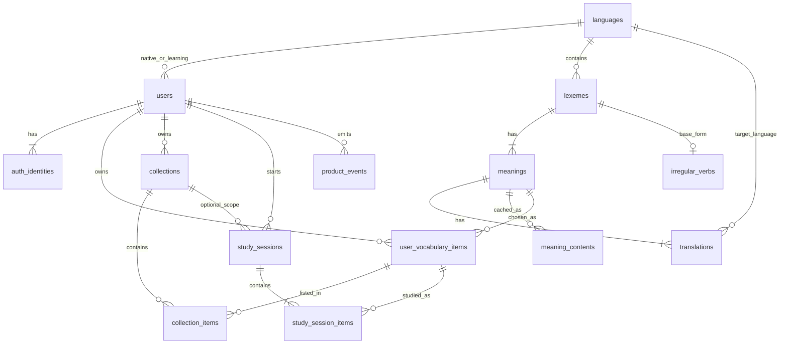

# Справочник: база данных

Этот документ — рабочий ориентир на шагах 11–13, 25, 26, 43, 48 и 58. Сюда возвращайтесь каждый
раз, когда создаёте модель, пишете репозиторий или смотрите сгенерированную миграцию.

Python здесь не предполагается «родным» языком. Код моделей можно копировать целиком. Смысл полей
и ограничений описан вокруг кода, не внутри него: в исходниках проекта комментариев быть не должно.

Источник истины по составу таблиц — продуктовый план, раздел 12. Если расхождение — править нужно
этот справочник и план вместе, а не «как быстрее влезло в файл».

---

## 1. Как устроена схема

PostgreSQL — единственное место, где живут долгие данные. Redis хранит только сессии очередей,
локи enrichment и счётчики лимитов. Angular не является источником истины.

Два семейства идентификаторов:

| Семейство | Тип PK | Кто | Зачем |
| --- | --- | --- | --- |
| Личные сущности | `UUID` | `User`, `AuthIdentity`, `UserVocabularyItem`, `Collection`, `StudySession` | UUID попадает в URL; по нему нельзя перебрать чужие записи (`/vocabulary/1`, `/vocabulary/2`, …) |
| Общий лексикон и справочники | `bigint` | `Language`, `Lexeme`, `Meaning`, `Translation`, `MeaningContent`, `IrregularVerb`, `ProductEvent` | Много строк, шарятся между пользователями, компактный ключ дешевле в индексах и FK |

Telegram ID **не является** первичным ключом пользователя. Он лежит в
`AuthIdentity.external_user_id`. Иначе нельзя будет добавить Apple/Google/email, не ломая схему.

Правило колонок SQLAlchemy 2.x, которое нельзя нарушать:

* `Mapped[str]` → `NOT NULL`
* `Mapped[str | None]` → колонка допускает `NULL`

Аннотация управляет схемой. Если в модели `Mapped[str]`, а в базе NULL разрешён, рассинхрон
всплывёт только на реальных данных.

---

## 2. Общие данные и персональные данные

Это главное продуктовое разделение схемы. Перепутаете — либо начнёте плодить definition на каждого
пользователя (деньги и время), либо положите чужой `source_context` в общий кэш.

### Общие (переиспользуются всеми)

| Таблица | Что это | Удаляется при удалении аккаунта? |
| --- | --- | --- |
| `languages` | Справочник языков | нет |
| `lexemes` | Слово или фраза в конкретном языке | нет |
| `meanings` | Одно значение лексемы | нет |
| `translations` | Перевод значения на язык пользователя | нет |
| `meaning_contents` | AI definition + example для значения и CEFR | нет |
| `irregular_verbs` | Формы системной темы | нет |
| `collections` с `is_system = true` | Системные темы, `user_id IS NULL` | нет |

Аудио в MVP — это поля `audio_url` / `audio_source` на `lexemes` и три URL на `irregular_verbs`.
Это ссылки на общие файлы, не персональные вложения.

### Персональные (только этот пользователь)

| Таблица / поле | Что это | Удаляется вместе с пользователем? |
| --- | --- | --- |
| `users` | Профиль, языки, CEFR, onboarding | да |
| `auth_identities` | Связка с Telegram | да, `CASCADE` |
| `user_vocabulary_items` | Выбор значения в личный словарь | да, `CASCADE` |
| `source_context`, `personal_note` | Личный контекст и заметка | да, вместе с карточкой |
| `collections` с `user_id IS NOT NULL` | Пользовательские темы | да, `CASCADE` |
| `collection_items` | Связь «тема ↔ карточка» | да, `CASCADE` |
| `study_sessions`, `study_session_items` | Занятия | да, `CASCADE` |
| `product_events` | Аналитика действий | да, `CASCADE` |

`source_context` нельзя копировать в `MeaningContent`. Это личная фраза пользователя, она уходит в
AI только как fallback значений, не как общий учебный текст.

«Все слова» на главном экране — **не** коллекция. Это представление всех `UserVocabularyItem`
пользователя. Не создавайте для этого системную тему.

---

## 3. Почему `MeaningContent` ключуется так

Уникальность:

```text
(meaning_id, cefr_level, prompt_version)
```

Три части — три разные причины.

**`meaning_id`.** Definition и example относятся к конкретному значению, не к слову целиком.
У `bank` значения «берег» и «банк» не должны делить один example.

**`cefr_level`.** Текст для A2 короче и проще, чем для B2. Пользователь с уровнем A2 не должен
получить формулировку C1, даже если другой пользователь уже сгенерировал её для того же значения.

**`prompt_version`.** Промпт живёт в коде (`ai_prompt_version`, по умолчанию `v1`) и входит в ключ
кэша. Смена промпта **не** перегенерирует старые строки. Иначе одно изменение текста стоило бы
перегенерации всей таблицы. Новая версия просто начинает писать новые строки рядом со старыми.
Карточки продолжают ссылаться на значение; сервис enrichment берёт контент текущей версии, а если
его нет — генерирует.

Защита от двойной генерации (два Celery-воркера, два пользователя, одно значение):

1. unique constraint в PostgreSQL — вторая вставка получит `IntegrityError`;
2. Redis-лок `SET NX EX` на ключ `enrichment:meaning-content:{meaning_id}:{cefr}:{version}` — шаг 38;
3. статус `GENERATING` на строке `MeaningContent`, чтобы второй воркер увидел «уже пишут» и подождал.

Это общий кэш, не персональная таблица. Сто карточек «clarify / значение 1 / A2» читают одну строку.

---

## 4. ER-обзор



Стрелка «личный → общий» всегда `ondelete="RESTRICT"`: удаление пользователя не трогает лексикон.
Стрелка «родитель → личный ребёнок» — `CASCADE`.

`Collection.user_id` допускает `NULL`: так живут системные темы (неправильные глаголы). У обычной
темы `user_id` обязателен на уровне сервиса, даже если колонка технически nullable.

---

## 5. Enum-ы

Все закрытые наборы состояний — `StrEnum`. Значение члена — то, что попадёт в PostgreSQL enum и в
JSON. Не пишите строковые литералы `"A2"` / `"PENDING"` в сервисах: опечатка пройдёт компилятор.

Общие для нескольких таблиц типы создаются **один раз**. `cefr_level` используется и в `users`, и в
`meaning_contents` — в обеих моделях `name="cefr_level"`. Alembic во второй миграции должен получить
`create_type=False`, иначе upgrade упадёт с `type already exists`.

```python
from enum import StrEnum


class CefrLevel(StrEnum):
    A1 = "A1"
    A2 = "A2"
    B1 = "B1"
    B2 = "B2"
    C1 = "C1"
    C2 = "C2"


class AuthProvider(StrEnum):
    TELEGRAM = "telegram"


class LexemeType(StrEnum):
    WORD = "word"
    PHRASE = "phrase"


class EnrichmentStatus(StrEnum):
    PENDING = "PENDING"
    ENRICHING = "ENRICHING"
    READY = "READY"
    PARTIAL = "PARTIAL"
    FAILED = "FAILED"


class MeaningContentStatus(StrEnum):
    GENERATING = "GENERATING"
    READY = "READY"
    FAILED = "FAILED"


class StudySessionStatus(StrEnum):
    IN_PROGRESS = "IN_PROGRESS"
    COMPLETED = "COMPLETED"
    ABANDONED = "ABANDONED"


class StudyStage(StrEnum):
    INTRODUCTION = "INTRODUCTION"
    MATCHING = "MATCHING"
    SENTENCE = "SENTENCE"
    DEFINITION = "DEFINITION"


class ProductEventName(StrEnum):
    ONBOARDING_COMPLETED = "onboarding_completed"
    COLLECTION_CREATED = "collection_created"
    WORD_ADDED = "word_added"
    STUDY_STARTED = "study_started"
    STUDY_STAGE_COMPLETED = "study_stage_completed"
    STUDY_COMPLETED = "study_completed"
```

`CefrLevel` и `AuthProvider` живут в модулях `users` и `auth` (шаг 12). Остальные — рядом с той
таблицей, которая ими владеет. `MeaningContentStatus` не смешивайте с `EnrichmentStatus`: первый
описывает генерацию общей строки кэша, второй — готовность личной карточки. Карточка может быть
`PARTIAL` при готовом `MeaningContent`, если не скачалось только аудио.

Часть речи в `meanings.part_of_speech` хранится строкой (`noun`, `verb`, …). Набор значений задаёт
`PartOfSpeech` в `app/integrations/dictionary/provider.py`. В таблицу enum не выносим: словари
иногда присылают редкие ярлыки, и жёсткий PostgreSQL enum начнёт отвергать валидный lookup.

Этапы занятия для фразы: `INTRODUCTION` → `MATCHING` → `DEFINITION` (без `SENTENCE`). Это логика
сервиса, не отдельная схема в БД. В `current_stage` по-прежнему те же четыре значения enum.

---

## 6. Общая инфраструктура

### `backend/app/common/database.py`

Базовый класс и фабрика сессий создаются на шаге 10. Здесь только то, что модели обязаны импортировать:

```python
from collections.abc import AsyncGenerator

from sqlalchemy.ext.asyncio import AsyncEngine, AsyncSession, async_sessionmaker, create_async_engine
from sqlalchemy.orm import DeclarativeBase

from app.common.settings import get_settings


class Base(DeclarativeBase):
    pass


def create_engine() -> AsyncEngine:
    settings = get_settings()
    return create_async_engine(
        settings.database_url,
        echo=False,
        pool_size=5,
        max_overflow=5,
        pool_pre_ping=True,
    )


engine: AsyncEngine = create_engine()

session_factory: async_sessionmaker[AsyncSession] = async_sessionmaker(
    bind=engine,
    expire_on_commit=False,
    autoflush=False,
)


async def get_db_session() -> AsyncGenerator[AsyncSession, None]:
    async with session_factory() as session:
        try:
            yield session
        except Exception:
            await session.rollback()
            raise
```

`expire_on_commit=False` обязателен: после `commit()` сервис ещё читает поля объекта, чтобы собрать
ответ API. Без флага SQLAlchemy пойдёт в БД лениво и в async вы получите `MissingGreenlet`.

`get_db_session` **не вызывает** `commit()`. Только откат при исключении. Коммит — в сервисе.

### `backend/app/common/mixins.py`

```python
from datetime import datetime

from sqlalchemy import DateTime, func
from sqlalchemy.orm import Mapped, mapped_column


class TimestampMixin:
    created_at: Mapped[datetime] = mapped_column(
        DateTime(timezone=True), server_default=func.now(), nullable=False
    )
    updated_at: Mapped[datetime] = mapped_column(
        DateTime(timezone=True), server_default=func.now(), onupdate=func.now(), nullable=False
    )
```

`DateTime(timezone=True)` → тип `timestamptz`. Везде `datetime.now(UTC)`, никаких naive-дат.

### `backend/app/common/models_registry.py`

Alembic видит только импортированные классы. Забытый импорт = autogenerate не создаст таблицу или
предложит `drop_table` для существующей. Финальное содержимое после шага 58:

```python
from app.analytics.models import ProductEvent
from app.auth.models import AuthIdentity
from app.collections.models import Collection, CollectionItem
from app.common.database import Base
from app.languages.models import Language
from app.lexicon.models import Lexeme, Meaning, MeaningContent, Translation
from app.study.models import IrregularVerb, StudySession, StudySessionItem
from app.users.models import User
from app.vocabulary.models import UserVocabularyItem

__all__ = [
    "AuthIdentity",
    "Base",
    "Collection",
    "CollectionItem",
    "IrregularVerb",
    "Language",
    "Lexeme",
    "Meaning",
    "MeaningContent",
    "ProductEvent",
    "StudySession",
    "StudySessionItem",
    "Translation",
    "User",
    "UserVocabularyItem",
]
```

На шаге 12 в файле только `Language`, `User`, `AuthIdentity`. Добавляйте импорты в той же миграции,
в которой появляется таблица.

Проверка, что реестр полный:

```bash
cd backend
uv run python -c "from app.common.models_registry import Base; print(sorted(Base.metadata.tables))"
```

---

## 7. Модуль `languages`

Файл: `backend/app/languages/models.py`. Шаг 12.

`Language` — справочник. Для MVP две строки (`en`, `ru`), но `code` уникален, чтобы позже добавить
языки без правки PK.

```python
from sqlalchemy import String
from sqlalchemy.orm import Mapped, mapped_column

from app.common.database import Base


class Language(Base):
    __tablename__ = "languages"

    id: Mapped[int] = mapped_column(primary_key=True)
    code: Mapped[str] = mapped_column(String(8), unique=True, nullable=False)
    name: Mapped[str] = mapped_column(String(64), nullable=False)
```

`id` здесь `INTEGER` (как на шаге 12): строк будет мало. FK из `users` и `lexemes` должны быть того
же типа — обычный `Mapped[int]`, не `BigInteger`.

Сид — отдельная миграция на шаге 13, не `bulk_insert` внутри autogenerate. См. раздел 15.

---

## 8. Модуль `users`

Файл: `backend/app/users/models.py`. Шаг 12.

Пользователь создаётся в момент первого входа, **до** onboarding. Поэтому языки и CEFR nullable.
Факт прохождения onboarding — `onboarding_completed_at IS NOT NULL`, а не «все три поля заполнены».
Так проще для аналитики и идемпотентного `PATCH /users/me`.

```python
from datetime import datetime
from enum import StrEnum
from uuid import UUID, uuid4

from sqlalchemy import DateTime, Enum as SqlEnum, ForeignKey
from sqlalchemy.dialects.postgresql import UUID as PgUUID
from sqlalchemy.orm import Mapped, mapped_column, relationship

from app.common.database import Base
from app.common.mixins import TimestampMixin


class CefrLevel(StrEnum):
    A1 = "A1"
    A2 = "A2"
    B1 = "B1"
    B2 = "B2"
    C1 = "C1"
    C2 = "C2"


class User(Base, TimestampMixin):
    __tablename__ = "users"

    id: Mapped[UUID] = mapped_column(PgUUID(as_uuid=True), primary_key=True, default=uuid4)
    native_language_id: Mapped[int | None] = mapped_column(
        ForeignKey("languages.id", ondelete="RESTRICT")
    )
    learning_language_id: Mapped[int | None] = mapped_column(
        ForeignKey("languages.id", ondelete="RESTRICT")
    )
    cefr_level: Mapped[CefrLevel | None] = mapped_column(
        SqlEnum(CefrLevel, name="cefr_level", native_enum=True)
    )
    onboarding_completed_at: Mapped[datetime | None] = mapped_column(DateTime(timezone=True))

    identities: Mapped[list["AuthIdentity"]] = relationship(back_populates="user")
```

`native_enum=True` создаёт настоящий PostgreSQL `ENUM`. Значения в БД — `A1`, не `a1`. Запись
строки `"a2"` даст `InvalidTextRepresentation`.

Два FK на одну таблицу `languages` — нормально. В сервисе onboarding проверяйте, что
`learning_language_id` указывает на английский, а `native_language_id` — на русский. Схема это не
ограничивает: архитектура не должна быть намертво прибита к паре ru→en.

---

## 9. Модуль `auth`

Файл: `backend/app/auth/models.py`. Шаг 12.

```python
from enum import StrEnum
from uuid import UUID, uuid4

from sqlalchemy import Enum as SqlEnum, ForeignKey, String, UniqueConstraint
from sqlalchemy.dialects.postgresql import UUID as PgUUID
from sqlalchemy.orm import Mapped, mapped_column, relationship

from app.common.database import Base
from app.common.mixins import TimestampMixin


class AuthProvider(StrEnum):
    TELEGRAM = "telegram"


class AuthIdentity(Base, TimestampMixin):
    __tablename__ = "auth_identities"
    __table_args__ = (
        UniqueConstraint("provider", "external_user_id", name="uq_auth_identities_provider_external"),
    )

    id: Mapped[UUID] = mapped_column(PgUUID(as_uuid=True), primary_key=True, default=uuid4)
    user_id: Mapped[UUID] = mapped_column(
        ForeignKey("users.id", ondelete="CASCADE"), nullable=False, index=True
    )
    provider: Mapped[AuthProvider] = mapped_column(
        SqlEnum(AuthProvider, name="auth_provider", native_enum=True), nullable=False
    )
    external_user_id: Mapped[str] = mapped_column(String(64), nullable=False)

    user: Mapped["User"] = relationship(back_populates="identities")
```

Уникальность `(provider, external_user_id)` — единственная настоящая защита от двух пользователей
на один Telegram-аккаунт. Два параллельных первых входа оба пройдут `SELECT` «ещё нет» и оба
попробуют вставить. Без constraint получите дубли. Сервис ловит `IntegrityError` и перечитывает
строку (шаг 16).

`CASCADE` нужен удалению аккаунта на шаге 59. Позже в `AuthProvider` добавятся `apple`, `google`,
`email` — отдельной миграцией, с `ALTER TYPE ... ADD VALUE`. Autogenerate это часто не видит,
дописывайте руками.

---

## 10. Модуль `lexicon`

Файл: `backend/app/lexicon/models.py`. Шаг 25.

Четыре таблицы в одном файле: это один агрегат «лексема и её значения». Не разносите их по папкам
на MVP.

`CefrLevel` импортируется из `users`: PostgreSQL-тип уже существует после шага 12. Второй
`name="cefr_level"` должен ссылаться на него, а не создавать копию.

```python
from datetime import datetime
from enum import StrEnum

from sqlalchemy import (
    BigInteger,
    DateTime,
    Enum as SqlEnum,
    ForeignKey,
    Index,
    String,
    UniqueConstraint,
    func,
)
from sqlalchemy.orm import Mapped, mapped_column, relationship

from app.common.database import Base
from app.common.mixins import TimestampMixin
from app.users.models import CefrLevel


class LexemeType(StrEnum):
    WORD = "word"
    PHRASE = "phrase"


class MeaningContentStatus(StrEnum):
    GENERATING = "GENERATING"
    READY = "READY"
    FAILED = "FAILED"


class Lexeme(Base, TimestampMixin):
    __tablename__ = "lexemes"
    __table_args__ = (
        UniqueConstraint("language_id", "normalized_text", name="uq_lexemes_language_normalized"),
        Index(
            "ix_lexemes_normalized_text_trgm",
            "normalized_text",
            postgresql_using="gin",
            postgresql_ops={"normalized_text": "gin_trgm_ops"},
        ),
    )

    id: Mapped[int] = mapped_column(BigInteger, primary_key=True)
    language_id: Mapped[int] = mapped_column(
        ForeignKey("languages.id", ondelete="RESTRICT"), nullable=False, index=True
    )
    text: Mapped[str] = mapped_column(String(80), nullable=False)
    normalized_text: Mapped[str] = mapped_column(String(80), nullable=False)
    type: Mapped[LexemeType] = mapped_column(
        SqlEnum(LexemeType, name="lexeme_type", native_enum=True), nullable=False
    )
    ipa: Mapped[str | None] = mapped_column(String(120))
    audio_url: Mapped[str | None] = mapped_column(String(512))
    audio_source: Mapped[str | None] = mapped_column(String(64))

    meanings: Mapped[list["Meaning"]] = relationship(back_populates="lexeme")


class Meaning(Base):
    __tablename__ = "meanings"

    id: Mapped[int] = mapped_column(BigInteger, primary_key=True)
    lexeme_id: Mapped[int] = mapped_column(
        ForeignKey("lexemes.id", ondelete="RESTRICT"), nullable=False, index=True
    )
    part_of_speech: Mapped[str] = mapped_column(String(32), nullable=False)
    source: Mapped[str] = mapped_column(String(64), nullable=False)
    source_external_id: Mapped[str | None] = mapped_column(String(128))
    created_at: Mapped[datetime] = mapped_column(
        DateTime(timezone=True), server_default=func.now(), nullable=False
    )

    lexeme: Mapped["Lexeme"] = relationship(back_populates="meanings")
    translations: Mapped[list["Translation"]] = relationship(back_populates="meaning")
    contents: Mapped[list["MeaningContent"]] = relationship(back_populates="meaning")


class Translation(Base):
    __tablename__ = "translations"
    __table_args__ = (
        UniqueConstraint(
            "meaning_id",
            "language_id",
            "text",
            name="uq_translations_meaning_language_text",
        ),
    )

    id: Mapped[int] = mapped_column(BigInteger, primary_key=True)
    meaning_id: Mapped[int] = mapped_column(
        ForeignKey("meanings.id", ondelete="RESTRICT"), nullable=False, index=True
    )
    language_id: Mapped[int] = mapped_column(
        ForeignKey("languages.id", ondelete="RESTRICT"), nullable=False, index=True
    )
    text: Mapped[str] = mapped_column(String(200), nullable=False)
    source: Mapped[str] = mapped_column(String(64), nullable=False)

    meaning: Mapped["Meaning"] = relationship(back_populates="translations")


class MeaningContent(Base):
    __tablename__ = "meaning_contents"
    __table_args__ = (
        UniqueConstraint(
            "meaning_id",
            "cefr_level",
            "prompt_version",
            name="uq_meaning_contents_meaning_cefr_prompt",
        ),
    )

    id: Mapped[int] = mapped_column(BigInteger, primary_key=True)
    meaning_id: Mapped[int] = mapped_column(
        ForeignKey("meanings.id", ondelete="RESTRICT"), nullable=False, index=True
    )
    cefr_level: Mapped[CefrLevel] = mapped_column(
        SqlEnum(CefrLevel, name="cefr_level", native_enum=True), nullable=False
    )
    definition: Mapped[str | None] = mapped_column(String(500))
    example: Mapped[str | None] = mapped_column(String(500))
    provider: Mapped[str] = mapped_column(String(64), nullable=False)
    model: Mapped[str] = mapped_column(String(64), nullable=False)
    prompt_version: Mapped[str] = mapped_column(String(32), nullable=False)
    status: Mapped[MeaningContentStatus] = mapped_column(
        SqlEnum(MeaningContentStatus, name="meaning_content_status", native_enum=True),
        nullable=False,
    )
    generated_at: Mapped[datetime | None] = mapped_column(DateTime(timezone=True))

    meaning: Mapped["Meaning"] = relationship(back_populates="contents")
```

`text` — исходное написание, `normalized_text` — после шага 27 (регистр, пробелы); unique и поиск
идут по нему. Лемматизации нет: `run` и `running` — разные лексемы. Длина фразы (до 5 слов / 80
символов) проверяется в сервисе, не CHECK. `ipa` и аудио nullable: нет звука → личная карточка
`PARTIAL`, не `FAILED`. `source` — имя провайдера (`yandex`, `wiktionary`, `ai`). `definition` /
`example` пустые, пока статус `GENERATING`.

GIN на `normalized_text` нужен `similarity()` (`clarfy` → `clarify`). Autogenerate часто рисует
btree вместо GIN — допишите руками, раздел 19.4.

Поиск с триграммами в репозитории:

```python
from sqlalchemy import func, select

from app.lexicon.models import Lexeme

SIMILARITY_THRESHOLD = 0.4


def suggest_lexeme_statement(language_id: int, normalized_text: str):
    similarity = func.similarity(Lexeme.normalized_text, normalized_text)
    return (
        select(Lexeme, similarity.label("score"))
        .where(
            Lexeme.language_id == language_id,
            Lexeme.normalized_text != normalized_text,
            similarity > SIMILARITY_THRESHOLD,
        )
        .order_by(similarity.desc())
        .limit(1)
    )
```

Без миграции расширений `pg_trgm` этот запрос падает: `function similarity(...) does not exist`.

---

## 11. Модуль `vocabulary`

Файл: `backend/app/vocabulary/models.py`. Шаг 26.

Одна строка = «этот пользователь выбрал это значение». Не храните здесь definition, IPA и аудио —
они общие. Здесь только личное: контекст, заметка, счётчик занятий, статус обогащения.

```python
from datetime import datetime
from enum import StrEnum
from uuid import UUID, uuid4

from sqlalchemy import DateTime, Enum as SqlEnum, ForeignKey, Integer, String, UniqueConstraint, text
from sqlalchemy.dialects.postgresql import UUID as PgUUID
from sqlalchemy.orm import Mapped, mapped_column, relationship

from app.common.database import Base
from app.common.mixins import TimestampMixin


class EnrichmentStatus(StrEnum):
    PENDING = "PENDING"
    ENRICHING = "ENRICHING"
    READY = "READY"
    PARTIAL = "PARTIAL"
    FAILED = "FAILED"


class UserVocabularyItem(Base, TimestampMixin):
    __tablename__ = "user_vocabulary_items"
    __table_args__ = (
        UniqueConstraint("user_id", "meaning_id", name="uq_user_vocabulary_items_user_meaning"),
    )

    id: Mapped[UUID] = mapped_column(PgUUID(as_uuid=True), primary_key=True, default=uuid4)
    user_id: Mapped[UUID] = mapped_column(
        ForeignKey("users.id", ondelete="CASCADE"), nullable=False, index=True
    )
    meaning_id: Mapped[int] = mapped_column(
        ForeignKey("meanings.id", ondelete="RESTRICT"), nullable=False, index=True
    )
    source_context: Mapped[str | None] = mapped_column(String(500))
    personal_note: Mapped[str | None] = mapped_column(String(500))
    study_count: Mapped[int] = mapped_column(
        Integer, nullable=False, default=0, server_default=text("0")
    )
    last_studied_at: Mapped[datetime | None] = mapped_column(DateTime(timezone=True))
    enrichment_status: Mapped[EnrichmentStatus] = mapped_column(
        SqlEnum(EnrichmentStatus, name="enrichment_status", native_enum=True),
        nullable=False,
        default=EnrichmentStatus.PENDING,
        server_default=EnrichmentStatus.PENDING.value,
    )

    meaning: Mapped["Meaning"] = relationship()
    collection_items: Mapped[list["CollectionItem"]] = relationship(
        back_populates="vocabulary_item"
    )
```

Для `source_context` и `personal_note` лимит 500 символов совпадает с продуктовым планом. Pydantic-схема
на шаге 37 дублирует его: клиентская проверка не заменяет ограничение в БД.

Unique `(user_id, meaning_id)` — повторный выбор того же значения не создаёт вторую карточку.
Сервис на шаге 37 ловит конфликт и возвращает уже существующую.

`study_count` по умолчанию 0 и в Python, и в PostgreSQL. `last_studied_at` остаётся `NULL`, пока
пользователь ни разу не завершил занятие с этой карточкой. Отбор «новые сначала» на шаге 44
сортирует по `study_count ASC`, затем `created_at ASC`.

`meaning_id` — `RESTRICT`: удаление значения из лексикона не снесёт чужие словари. Удаляется только
личная строка (`DELETE /vocabulary/{id}`), общее `Meaning` остаётся.

Карточка с `PENDING` / `ENRICHING` в занятие не попадает. `PARTIAL` — попадает: перевод и IPA уже
есть, не хватает необязательного поля.

---

## 12. Модуль `collections`

Файл: `backend/app/collections/models.py`. Шаг 26.

`CollectionItem` — чистая many-to-many. Отдельного `id` у связи нет: составной PK
`(collection_id, user_vocabulary_item_id)`. Одна карточка может лежать в нескольких темах.

```python
from datetime import datetime
from uuid import UUID, uuid4

from sqlalchemy import Boolean, DateTime, ForeignKey, Index, String, false, func, text
from sqlalchemy.dialects.postgresql import UUID as PgUUID
from sqlalchemy.orm import Mapped, mapped_column, relationship

from app.common.database import Base
from app.common.mixins import TimestampMixin


class Collection(Base, TimestampMixin):
    __tablename__ = "collections"
    __table_args__ = (
        Index(
            "uq_collections_user_name",
            "user_id",
            "name",
            unique=True,
            postgresql_where=text("user_id IS NOT NULL"),
        ),
        Index(
            "uq_collections_system_name",
            "name",
            unique=True,
            postgresql_where=text("is_system = true"),
        ),
    )

    id: Mapped[UUID] = mapped_column(PgUUID(as_uuid=True), primary_key=True, default=uuid4)
    user_id: Mapped[UUID | None] = mapped_column(
        ForeignKey("users.id", ondelete="CASCADE"), index=True
    )
    name: Mapped[str] = mapped_column(String(80), nullable=False)
    description: Mapped[str | None] = mapped_column(String(500))
    is_system: Mapped[bool] = mapped_column(
        Boolean, nullable=False, default=False, server_default=false()
    )

    items: Mapped[list["CollectionItem"]] = relationship(
        back_populates="collection",
        cascade="all, delete-orphan",
    )


class CollectionItem(Base):
    __tablename__ = "collection_items"

    collection_id: Mapped[UUID] = mapped_column(
        PgUUID(as_uuid=True),
        ForeignKey("collections.id", ondelete="CASCADE"),
        primary_key=True,
    )
    user_vocabulary_item_id: Mapped[UUID] = mapped_column(
        PgUUID(as_uuid=True),
        ForeignKey("user_vocabulary_items.id", ondelete="CASCADE"),
        primary_key=True,
        index=True,
    )
    created_at: Mapped[datetime] = mapped_column(
        DateTime(timezone=True), server_default=func.now(), nullable=False
    )

    collection: Mapped["Collection"] = relationship(back_populates="items")
    vocabulary_item: Mapped["UserVocabularyItem"] = relationship(
        back_populates="collection_items"
    )
```

Почему `user_id` nullable: системная тема неправильных глаголов принадлежит приложению, не
пользователю. Её создаёт миграция шага 48 (`is_system=true`, `user_id=NULL`). Пользовательские темы
сервис создаёт только с заполненным `user_id`.

Частичные unique-индексы:

* у одного пользователя нет двух тем с одним именем;
* системных тем с одним именем тоже нет;
* `NULL` в обычном `UNIQUE (user_id, name)` в PostgreSQL не мешает дубликатам системных строк —
  поэтому обычного unique constraint недостаточно.

`CASCADE` на обоих FK `CollectionItem`: удалили тему — связи исчезли, карточки словаря остались.
Удалили карточку — она пропала из всех тем.

Не кладите в `CollectionItem` системные глаголы как `UserVocabularyItem`. Неправильные глаголы —
отдельная таблица `irregular_verbs`. Системная коллекция на главном экране — точка входа в другой
flow, не список личных карточек.

Autogenerate часто не умеет `postgresql_where`. Индексы после генерации проверьте и при
необходимости замените на `op.execute(...)` — рецепт в разделе 15.

---

## 13. Модуль `study`

Файл: `backend/app/study/models.py`. Сессии — шаг 43, неправильные глаголы — шаг 48.

```python
from datetime import datetime
from enum import StrEnum
from uuid import UUID, uuid4

from sqlalchemy import (
    BigInteger,
    DateTime,
    Enum as SqlEnum,
    ForeignKey,
    Index,
    Integer,
    String,
    UniqueConstraint,
    func,
    text,
)
from sqlalchemy.dialects.postgresql import UUID as PgUUID
from sqlalchemy.orm import Mapped, mapped_column, relationship

from app.common.database import Base


class StudySessionStatus(StrEnum):
    IN_PROGRESS = "IN_PROGRESS"
    COMPLETED = "COMPLETED"
    ABANDONED = "ABANDONED"


class StudyStage(StrEnum):
    INTRODUCTION = "INTRODUCTION"
    MATCHING = "MATCHING"
    SENTENCE = "SENTENCE"
    DEFINITION = "DEFINITION"


class StudySession(Base):
    __tablename__ = "study_sessions"
    __table_args__ = (
        Index(
            "uq_study_sessions_user_in_progress",
            "user_id",
            unique=True,
            postgresql_where=text("status = 'IN_PROGRESS'"),
        ),
    )

    id: Mapped[UUID] = mapped_column(PgUUID(as_uuid=True), primary_key=True, default=uuid4)
    user_id: Mapped[UUID] = mapped_column(
        ForeignKey("users.id", ondelete="CASCADE"), nullable=False, index=True
    )
    collection_id: Mapped[UUID | None] = mapped_column(
        ForeignKey("collections.id", ondelete="SET NULL"), index=True
    )
    status: Mapped[StudySessionStatus] = mapped_column(
        SqlEnum(StudySessionStatus, name="study_session_status", native_enum=True),
        nullable=False,
    )
    current_stage: Mapped[StudyStage] = mapped_column(
        SqlEnum(StudyStage, name="study_stage", native_enum=True), nullable=False
    )
    started_at: Mapped[datetime] = mapped_column(
        DateTime(timezone=True), server_default=func.now(), nullable=False
    )
    completed_at: Mapped[datetime | None] = mapped_column(DateTime(timezone=True))

    items: Mapped[list["StudySessionItem"]] = relationship(
        back_populates="session",
        order_by="StudySessionItem.position",
        cascade="all, delete-orphan",
    )


class StudySessionItem(Base):
    __tablename__ = "study_session_items"
    __table_args__ = (
        UniqueConstraint(
            "session_id",
            "position",
            name="uq_study_session_items_session_position",
        ),
    )

    session_id: Mapped[UUID] = mapped_column(
        PgUUID(as_uuid=True),
        ForeignKey("study_sessions.id", ondelete="CASCADE"),
        primary_key=True,
    )
    user_vocabulary_item_id: Mapped[UUID] = mapped_column(
        PgUUID(as_uuid=True),
        ForeignKey("user_vocabulary_items.id", ondelete="CASCADE"),
        primary_key=True,
        index=True,
    )
    position: Mapped[int] = mapped_column(Integer, nullable=False)

    session: Mapped["StudySession"] = relationship(back_populates="items")
    vocabulary_item: Mapped["UserVocabularyItem"] = relationship()


class IrregularVerb(Base):
    __tablename__ = "irregular_verbs"

    id: Mapped[int] = mapped_column(BigInteger, primary_key=True)
    base_lexeme_id: Mapped[int] = mapped_column(
        ForeignKey("lexemes.id", ondelete="RESTRICT"), nullable=False, unique=True
    )
    past_simple: Mapped[str] = mapped_column(String(80), nullable=False)
    past_participle: Mapped[str] = mapped_column(String(80), nullable=False)
    base_audio_url: Mapped[str | None] = mapped_column(String(512))
    past_audio_url: Mapped[str | None] = mapped_column(String(512))
    participle_audio_url: Mapped[str | None] = mapped_column(String(512))
    translation: Mapped[str] = mapped_column(String(200), nullable=False)

    base_lexeme: Mapped["Lexeme"] = relationship()
```

`collection_id` nullable: занятие по «всем словам» не привязано к теме. `ON DELETE SET NULL` —
удаление темы не уничтожает историю занятий, только отвязывает их.

Частичный unique `один IN_PROGRESS на пользователя` нужен восстановлению сессии (шаг 57). Вторую
активную сессию база не даст создать, даже если два запроса уйдут одновременно.

`StudySessionItem` фиксирует набор карточек в момент старта. Дальнейшие добавления в словарь на
текущее занятие не влияют. `position` — порядок показа, с 0.

Три audio URL у глагола не дублируют модель карточки: у неправильного глагола три формы, у
`Lexeme` — одна. `base_lexeme_id` уникален: один глагол — одна лексема базовой формы.

`ABANDONED` ставит сервис, когда пользователь явно бросает занятие или начинает новое, закрыв
старое. Не используйте его как default.

---

## 14. Модуль `analytics`

Файл: `backend/app/analytics/models.py`. Шаг 58.

```python
from datetime import datetime
from enum import StrEnum
from uuid import UUID

from sqlalchemy import BigInteger, DateTime, Enum as SqlEnum, ForeignKey, String, func, text
from sqlalchemy.dialects.postgresql import JSONB, UUID as PgUUID
from sqlalchemy.orm import Mapped, mapped_column

from app.common.database import Base


class ProductEventName(StrEnum):
    ONBOARDING_COMPLETED = "onboarding_completed"
    COLLECTION_CREATED = "collection_created"
    WORD_ADDED = "word_added"
    STUDY_STARTED = "study_started"
    STUDY_STAGE_COMPLETED = "study_stage_completed"
    STUDY_COMPLETED = "study_completed"


class ProductEvent(Base):
    __tablename__ = "product_events"

    id: Mapped[int] = mapped_column(BigInteger, primary_key=True)
    user_id: Mapped[UUID] = mapped_column(
        ForeignKey("users.id", ondelete="CASCADE"), nullable=False, index=True
    )
    event_name: Mapped[ProductEventName] = mapped_column(
        SqlEnum(ProductEventName, name="product_event_name", native_enum=True),
        nullable=False,
        index=True,
    )
    payload: Mapped[dict[str, object]] = mapped_column(
        JSONB, nullable=False, server_default=text("'{}'::jsonb")
    )
    created_at: Mapped[datetime] = mapped_column(
        DateTime(timezone=True), server_default=func.now(), nullable=False, index=True
    )
```

Пишите событие в том же сервисе, который совершил действие, **после** успешного `commit`
основной операции либо в той же транзакции. Не пишите из Angular: клиенту нельзя доверять.

В `payload` — только то, что нужно для метрик (`collection_id`, `stage`, `item_count`). Не кладите
`source_context`, тексты карточек и Telegram initData.

`CASCADE` с пользователем: удаление аккаунта стирает и аналитику этого человека. Агрегированные
отчёты после MVP считайте до удаления или выносите в отдельное хранилище без PII — не сейчас.

---

## 15. Правила `ondelete`

| FK | Правило | Почему |
| --- | --- | --- |
| `users.native_language_id` → `languages` | `RESTRICT` | справочник общий |
| `users.learning_language_id` → `languages` | `RESTRICT` | справочник общий |
| `auth_identities.user_id` → `users` | `CASCADE` | личный ребёнок |
| `lexemes.language_id` → `languages` | `RESTRICT` | лексикон общий |
| `meanings.lexeme_id` → `lexemes` | `RESTRICT` | лексикон общий |
| `translations.meaning_id` → `meanings` | `RESTRICT` | лексикон общий |
| `translations.language_id` → `languages` | `RESTRICT` | лексикон общий |
| `meaning_contents.meaning_id` → `meanings` | `RESTRICT` | общий кэш |
| `user_vocabulary_items.user_id` → `users` | `CASCADE` | личный ребёнок |
| `user_vocabulary_items.meaning_id` → `meanings` | `RESTRICT` | значение шарится |
| `collections.user_id` → `users` | `CASCADE` | личные темы; системные с `NULL` не задеваются |
| `collection_items.collection_id` → `collections` | `CASCADE` | связь принадлежит теме |
| `collection_items.user_vocabulary_item_id` → `user_vocabulary_items` | `CASCADE` | связь принадлежит карточке |
| `study_sessions.user_id` → `users` | `CASCADE` | личный ребёнок |
| `study_sessions.collection_id` → `collections` | `SET NULL` | тема nullable, история занятий ценнее |
| `study_session_items.session_id` → `study_sessions` | `CASCADE` | состав сессии |
| `study_session_items.user_vocabulary_item_id` → `user_vocabulary_items` | `CASCADE` | личный ребёнок |
| `irregular_verbs.base_lexeme_id` → `lexemes` | `RESTRICT` | общий справочник |
| `product_events.user_id` → `users` | `CASCADE` | персональные данные |

Проверка при ревью миграции: в `op.create_foreign_key` / `sa.ForeignKey` есть явный `ondelete`.
Если Alembic сгенерировал FK без него — допишите.

---

## 16. Транзакции: владеет сервис

Репозиторий не вызывает `commit()`. Он делает `add` / `delete` и `flush()`, когда сразу нужен
сгенерированный id (например, чтобы поставить Celery-задачу с `item.id`). Сервис собирает несколько
репозиториев в одну сессию и коммитит **один раз** в конце:

```python
item = UserVocabularyItem(
    user_id=user_id,
    meaning_id=meaning_id,
    source_context=source_context,
    enrichment_status=EnrichmentStatus.PENDING,
)
await self._vocabulary_repository.add(item)
await self._collection_repository.add_item_links(item.id, collection_ids)
await session.commit()
self._enqueue_enrichment(item.id)
```

`flush()` отправляет SQL, откат ещё возможен. `commit()` фиксирует. Провайдеры (HTTP) не вызывайте
внутри открытой транзакции: соединение из пула будет занято на время сети. Сначала внешний вызов,
потом короткая запись.

`get_db_session` откатит транзакцию при исключении. Карточка и связи с темами либо сохраняются
вместе, либо не сохраняются вовсе. Celery открывает **свою** сессию через `task_runtime`, не через
HTTP-зависимость.

---

## 17. `selectinload`: чтобы не поймать `MissingGreenlet` и N+1

В async-режиме ленивая загрузка `lexeme.meanings` запрещена. Нужен явный `options(...)`.
`selectinload` делает **один** дополнительный `IN (...)` на уровень связи — и для списка из 20
карточек, и для одной.

Lookup лексемы (шаг 34):

```python
from sqlalchemy import select
from sqlalchemy.orm import selectinload

from app.lexicon.models import Lexeme, Meaning

statement = (
    select(Lexeme)
    .where(
        Lexeme.language_id == language_id,
        Lexeme.normalized_text == normalized_text,
    )
    .options(
        selectinload(Lexeme.meanings).selectinload(Meaning.translations),
        selectinload(Lexeme.meanings).selectinload(Meaning.contents),
    )
)
```

Список словаря (шаг 39) — карточка + лексема + перевод + контент текущего CEFR:

```python
from app.vocabulary.models import UserVocabularyItem

statement = (
    select(UserVocabularyItem)
    .where(UserVocabularyItem.user_id == user_id)
    .options(
        selectinload(UserVocabularyItem.meaning).selectinload(Meaning.lexeme),
        selectinload(UserVocabularyItem.meaning).selectinload(Meaning.translations),
        selectinload(UserVocabularyItem.meaning).selectinload(Meaning.contents),
        selectinload(UserVocabularyItem.collection_items),
    )
    .order_by(UserVocabularyItem.created_at.desc())
)
```

Тема с карточками (шаг 36):

```python
from app.collections.models import Collection, CollectionItem

statement = (
    select(Collection)
    .where(Collection.id == collection_id)
    .options(
        selectinload(Collection.items)
        .selectinload(CollectionItem.vocabulary_item)
        .selectinload(UserVocabularyItem.meaning)
        .selectinload(Meaning.lexeme)
    )
)
```

Сессия занятия (шаг 46):

```python
from app.study.models import StudySession, StudySessionItem

statement = (
    select(StudySession)
    .where(StudySession.id == session_id)
    .options(
        selectinload(StudySession.items)
        .selectinload(StudySessionItem.vocabulary_item)
        .selectinload(UserVocabularyItem.meaning)
        .selectinload(Meaning.lexeme),
        selectinload(StudySession.items)
        .selectinload(StudySessionItem.vocabulary_item)
        .selectinload(UserVocabularyItem.meaning)
        .selectinload(Meaning.translations),
        selectinload(StudySession.items)
        .selectinload(StudySessionItem.vocabulary_item)
        .selectinload(UserVocabularyItem.meaning)
        .selectinload(Meaning.contents),
    )
)
```

Если увидели `MissingGreenlet` — в этом запросе не хватает `selectinload`. Не ставьте
`lazy="selectin"` на все `relationship` глобально: тогда каждая случайная навигация будет
стрелять SQL. Явный `options` в репозитории проще читать.

`joinedload` для коллекций даёт декартово произведение (сессия × items × translations × contents).
Для списков с несколькими one-to-many ветками берите `selectinload`.

---

## 18. MediaAsset в MVP нет

В продуктовом плане изображения — post-MVP. **Не добавляйте** таблицу `media_assets` и не вешайте
`image_url` на `UserVocabularyItem` / `Meaning` / `MeaningContent`.

Аудио сейчас — обычные строковые URL на `Lexeme` и `IrregularVerb`. Этого достаточно, чтобы
карточка работала.

Когда изображения понадобятся, добавляется **новая** таблица, без изменения модели карточки:

```text
media_assets
  id              bigint
  meaning_id      bigint  FK meanings RESTRICT
  kind            image | audio
  storage_key     text
  public_url      text
  mime_type       text
  source          text
  status          pending | ready | failed
  created_at
```

Карточка по-прежнему указывает только на `meaning_id`. Сервис полной карточки подгружает
`MediaAsset` тем же `selectinload` (или отдельным запросом). `UserVocabularyItem` не меняется:
картинка общая для значения, не личная. Object storage key не живёт в JSONB персональной таблицы.

Так и выполняется требование плана: «добавить MediaAsset без изменения основной модели карточки».

---

## 19. Рецепты Alembic

Рабочий цикл на каждой миграции:

```bash
cd backend
POSTGRES_HOST=localhost uv run alembic revision --autogenerate -m "краткое описание"
```

Дальше **откройте файл**. Autogenerate — черновик. Примените только после правки:

```bash
POSTGRES_HOST=localhost uv run alembic upgrade head
POSTGRES_HOST=localhost uv run alembic downgrade -1
POSTGRES_HOST=localhost uv run alembic upgrade head
```

Пока в базе нет ценных данных, обратимость проверяйте всегда.

### 19.1. Расширения PostgreSQL

Autogenerate расширения не создаёт. Первая миграция пишется вручную.

```bash
uv run alembic revision -m "enable postgres extensions"
```

```python
from alembic import op

revision: str = "<сгенерированное значение>"
down_revision: str | None = None
branch_labels: None = None
depends_on: None = None


def upgrade() -> None:
    op.execute('CREATE EXTENSION IF NOT EXISTS "uuid-ossp"')
    op.execute("CREATE EXTENSION IF NOT EXISTS pg_trgm")


def downgrade() -> None:
    op.execute("DROP EXTENSION IF EXISTS pg_trgm")
    op.execute('DROP EXTENSION IF EXISTS "uuid-ossp"')
```

`pg_trgm` даёт `similarity()` и операторный класс `gin_trgm_ops`. `uuid-ossp` — генерация UUID на
стороне БД, если понадобится `server_default`. Python-`default=uuid4` работает и без расширения;
расширение всё равно включаем сразу, чтобы не ловить сюрприз на production.

### 19.2. Enum-типы

После autogenerate шага 12 в `downgrade()` почти наверняка не будет удаления типов. Добавьте сами:

```python
def downgrade() -> None:
    op.drop_table("auth_identities")
    op.drop_table("users")
    op.drop_table("languages")
    op.execute("DROP TYPE IF EXISTS auth_provider")
    op.execute("DROP TYPE IF EXISTS cefr_level")
```

Иначе повторный upgrade после downgrade: `type "cefr_level" already exists`.

Когда `meaning_contents` переиспользует `cefr_level`, в `upgrade()` должно быть так:

```python
cefr_level = postgresql.ENUM(
    "A1", "A2", "B1", "B2", "C1", "C2",
    name="cefr_level",
    create_type=False,
)
cefr_level.create(op.get_bind(), checkfirst=True)
```

Либо колонку создают с уже существующим типом без `create_type=True`. Если Alembic вставил
`sa.Enum(..., create_type=True)` повторно — смените на `False`.

Новое значение в существующий enum:

```python
def upgrade() -> None:
    op.execute("ALTER TYPE auth_provider ADD VALUE IF NOT EXISTS 'apple'")


def downgrade() -> None:
    pass
```

Удаление значения из PostgreSQL enum штатно нельзя. `downgrade` для `ADD VALUE` оставляйте пустым
и не пытайтесь пересоздать тип на базе с данными.

### 19.3. Сид справочника

Миграция не импортирует ORM-модели: модель изменится, старая ревизия должна продолжать работать.
Используйте `sqlalchemy.table`.

```python
from alembic import op
from sqlalchemy import Integer, String, column, table

revision: str = "<сгенерированное значение>"
down_revision: str | None = "<ревизия шага 12>"

languages_table = table(
    "languages",
    column("id", Integer),
    column("code", String),
    column("name", String),
)

SEEDED_LANGUAGES = [
    {"id": 1, "code": "en", "name": "English"},
    {"id": 2, "code": "ru", "name": "Русский"},
]


def upgrade() -> None:
    op.bulk_insert(languages_table, SEEDED_LANGUAGES)
    op.execute("SELECT setval('languages_id_seq', (SELECT MAX(id) FROM languages))")


def downgrade() -> None:
    op.execute("DELETE FROM languages WHERE code IN ('en', 'ru')")
```

`setval` обязателен: вставка с явными id не двигает sequence, следующая вставка без id получит
`id=1` и упадёт на PK.

### 19.4. GIN-индекс `pg_trgm`

После autogenerate шага 25 найдите индекс по `lexemes.normalized_text`. Если там `op.create_index`
без `postgresql_using="gin"` — удалите его и допишите:

```python
def upgrade() -> None:
    op.execute(
        "CREATE INDEX ix_lexemes_normalized_text_trgm "
        "ON lexemes USING gin (normalized_text gin_trgm_ops)"
    )


def downgrade() -> None:
    op.execute("DROP INDEX IF EXISTS ix_lexemes_normalized_text_trgm")
```

Расширение `pg_trgm` уже должно быть с шага 11. Если индекс создаёте раньше расширения — upgrade
на чистой базе в CI упадёт. Порядок ревизий это гарантирует.

Проверка:

```bash
docker compose exec postgres psql -U vocabulary -d vocabulary -c "\d lexemes"
```

В списке индексов должна быть строка `gin (normalized_text gin_trgm_ops)`.

### 19.5. Частичные unique-индексы

Autogenerate для `postgresql_where` ненадёжен. Для коллекций и активной сессии безопаснее явный SQL:

```python
def upgrade() -> None:
    op.execute(
        "CREATE UNIQUE INDEX uq_collections_user_name "
        "ON collections (user_id, name) "
        "WHERE user_id IS NOT NULL"
    )
    op.execute(
        "CREATE UNIQUE INDEX uq_collections_system_name "
        "ON collections (name) "
        "WHERE is_system = true"
    )
    op.execute(
        "CREATE UNIQUE INDEX uq_study_sessions_user_in_progress "
        "ON study_sessions (user_id) "
        "WHERE status = 'IN_PROGRESS'"
    )
```

### 19.6. Сид неправильных глаголов и системной темы

Шаг 48. Сначала таблица (autogenerate), затем отдельная ревизия с данными — или данные в той же,
если таблица создаётся здесь же. Лексемы английского языка: `language_id = 1` из сида шага 13.

Идея upgrade:

1. вставить `lexemes` для базовых форм (`go`, `be`, `see`, …), `type = 'word'`;
2. `setval` последовательности `lexemes_id_seq`;
3. вставить `irregular_verbs` с `base_lexeme_id`;
4. вставить `collections` (`user_id = NULL`, `is_system = true`, `name = 'Неправильные глаголы'`).

Не импортируйте `Lexeme` / `IrregularVerb` в миграцию. `table()` + `bulk_insert`, как с языками.

Минимальный набор для проверки flow: `be/was/were/been`, `go/went/gone`, `see/saw/seen`,
`do/did/done`, `take/took/taken`. Остальные добавите на шаге 48. Аудио URL на сиде можно оставить
`NULL`.

---

## 20. Порядок миграций

Каждая строка — отдельный файл в `backend/alembic/versions/`. Не склеивайте шаги: откатывать и
читать историю проще по одному изменению.

| Шаг плана | Когда | Имя ревизии (ориентир) | Как создаётся | Что появляется |
| --- | --- | --- | --- | --- |
| **11** | Неделя 1, фундамент | `enable postgres extensions` | вручную, `alembic revision -m` | расширения `uuid-ossp`, `pg_trgm`; таблица `alembic_version` |
| **12** | Сразу после 11 | `add users languages auth identities` | `--autogenerate`, ревью | таблицы `languages`, `users`, `auth_identities`; enum `cefr_level`, `auth_provider`; unique на `languages.code` и `(provider, external_user_id)` |
| **13** | Сразу после 12 | `seed languages` | вручную | строки `en`, `ru`; `setval` для `languages_id_seq` |
| **25** | Неделя 2, лексикон | `add lexicon tables and pg_trgm index` | `--autogenerate` + ручной GIN | `lexemes`, `meanings`, `translations`, `meaning_contents`; enum `lexeme_type`, `meaning_content_status`; unique `(language_id, normalized_text)` и `(meaning_id, cefr_level, prompt_version)`; GIN `gin_trgm_ops` |
| **26** | Неделя 2, словарь и темы | `add vocabulary items and collections` | `--autogenerate` + частичные unique | `user_vocabulary_items`, `collections`, `collection_items`; enum `enrichment_status`; unique `(user_id, meaning_id)`; частичные unique имён тем |
| **43** | Неделя 3, занятия | `add study sessions` | `--autogenerate` + частичный unique | `study_sessions`, `study_session_items`; enum `study_session_status`, `study_stage`; unique один `IN_PROGRESS` на пользователя |
| **48** | Неделя 3, глаголы | `add irregular verbs` + `seed irregular verbs` | autogenerate таблицы, сид вручную | `irregular_verbs`; системная `collections` строка; лексемы базовых форм |
| **58** | Неделя 4, аналитика | `add product events` | `--autogenerate` | `product_events`; enum `product_event_name`; индексы по `user_id`, `event_name`, `created_at` |

Цепочка `down_revision` строго линейная: 11 → 12 → 13 → 25 → 26 → 43 → 48 → 58. Не ветвите
миграции с двух машин без `alembic merge`.

На шаге 48 допустимы две ревизии подряд (схема, затем сид) — тогда в таблице выше это два файла,
оба принадлежат шагу 48.

После каждой из этих ревизий:

```bash
POSTGRES_HOST=localhost uv run alembic current
POSTGRES_HOST=localhost uv run alembic history
```

`current` должен показывать одну голову. `Multiple head revisions` — остановитесь и чините цепочку,
не пишите следующую модель.

---

## 21. Типичные ошибки Alembic

**Применённую миграцию не редактируют.** Если ревизия уже у вас в `alembic_version`, у напарника
или на сервере — правьте схему новой ревизией. Исключение: файл ещё никто не применял, в том числе
CI. Тогда можно поправить до первого `upgrade`.

**Autogenerate не видит расширения.** `CREATE EXTENSION` только руками, шаг 11.

**Autogenerate плохо видит смену типа.** `String(80)` → `String(120)` без `compare_type=True` в
`env.py` пройдёт незамеченной. В проекте `compare_type=True` уже включён на шаге 11 — не убирайте.
Всё равно читайте diff: переименование колонки он часто превращает в `drop` + `create` (потеря
данных). Переименования пишите через `op.alter_column(..., new_column_name=...)`.

**Autogenerate не видит таблицу.** Нет импорта в `models_registry.py`. Сначала
`print(sorted(Base.metadata.tables))`, потом генерируйте.

**Autogenerate предлагает удалить таблицу.** Тот же пробел в реестре, либо вы смотрите не на ту
базу. Никогда не применяйте миграцию с неожиданным `drop_table` «потому что так сгенерилось».

**GIN / частичные индексы / `IF NOT EXISTS`.** Часто отсутствуют или превращаются в btree.
Дописывайте SQL.

**Enum в `downgrade`.** `drop_table` не удаляет тип. Без `DROP TYPE` следующий upgrade падает.

**Сид с явными id без `setval`.** Первая же вставка из приложения получит конфликт PK.

**Миграция зависит от текущих моделей.** Через месяц поле переименуют, старая ревизия на чистой
базе импортирует уже другой класс и сломается. Только `table()` / `op.execute`.

**Две головы.** Две ветки от одного `down_revision`. `alembic heads`, затем `merge` или правка
ещё не применённой ревизии. Применённые на production так не трогают.

**Миграция падает только в CI.** Локально расширение/тип/сиды вы создали руками. Чистая база
должна подниматься одним `alembic upgrade head` после `docker compose up postgres`. Проверяйте на
пустом томе, не на своей «уже починенной» базе.

**Секреты в миграциях.** Паролей, ключей API и initData в `versions/` быть не должно.

Команды: `alembic current`, `history`, `heads`, `upgrade head`, `downgrade -1`. С macOS всегда
`POSTGRES_HOST=localhost`, из контейнера — как в compose.

---

## 22. Карта таблиц

| Таблица | PK | Модуль | Шаг |
| --- | --- | --- | --- |
| `languages` | `int` | `languages` | 12, сид 13 |
| `users` | `UUID` | `users` | 12 |
| `auth_identities` | `UUID` | `auth` | 12 |
| `lexemes` | `bigint` | `lexicon` | 25 |
| `meanings` | `bigint` | `lexicon` | 25 |
| `translations` | `bigint` | `lexicon` | 25 |
| `meaning_contents` | `bigint` | `lexicon` | 25 |
| `user_vocabulary_items` | `UUID` | `vocabulary` | 26 |
| `collections` | `UUID` | `collections` | 26, системная строка 48 |
| `collection_items` | `(collection_id, user_vocabulary_item_id)` | `collections` | 26 |
| `study_sessions` | `UUID` | `study` | 43 |
| `study_session_items` | `(session_id, user_vocabulary_item_id)` | `study` | 43 |
| `irregular_verbs` | `bigint` | `study` | 48 |
| `product_events` | `bigint` | `analytics` | 58 |

Обязательные unique:

| Таблица | Ключ |
| --- | --- |
| `lexemes` | `(language_id, normalized_text)` |
| `user_vocabulary_items` | `(user_id, meaning_id)` |
| `meaning_contents` | `(meaning_id, cefr_level, prompt_version)` |
| `auth_identities` | `(provider, external_user_id)` |
| `languages` | `code` |
| `irregular_verbs` | `base_lexeme_id` |
| `study_session_items` | `(session_id, position)` |
| `collections` | частичный `(user_id, name)` и частичный `name` для `is_system` |
| `study_sessions` | частичный `user_id` где `status = IN_PROGRESS` |

---

## Что читать дальше

* Неделя 1, шаги 11–13 (Alembic, первые модели, сид языков) — [03-week1-foundation.md](03-week1-foundation.md)
* Неделя 2, шаги 25–26 (лексикон, личный словарь, темы) — [04-week2-vocabulary.md](04-week2-vocabulary.md)
* Неделя 3, шаги 43 и 48 (сессии, неправильные глаголы) — [05-week3-study.md](05-week3-study.md)
* Контракт REST, который эти таблицы обслуживают — [08-api-reference.md](08-api-reference.md)
