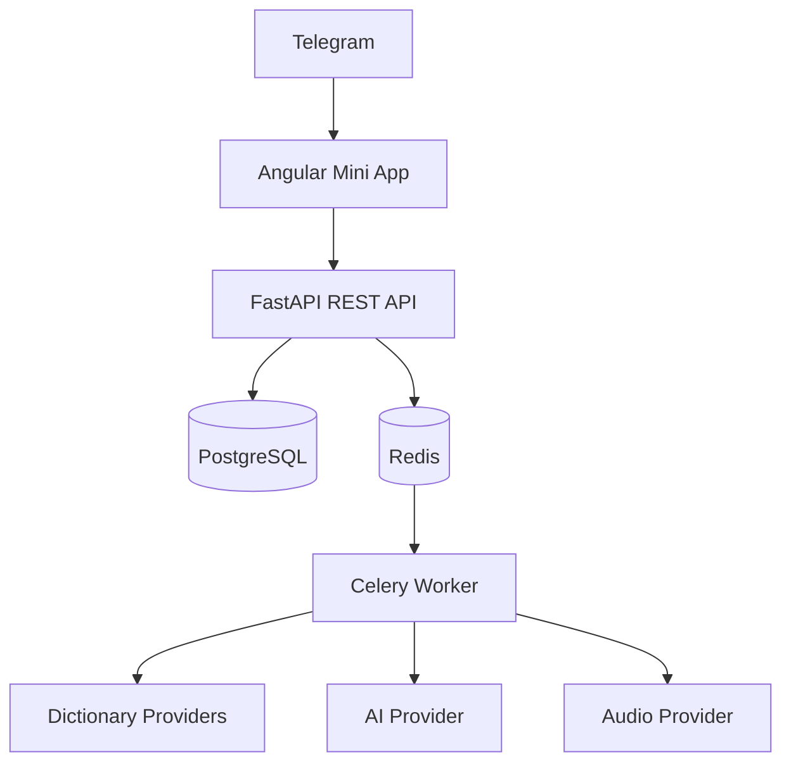

# English Vocabulary App — Product & Technical Plan

## 0. Статус документа

Этот документ фиксирует продуктовые и технические решения по проекту Telegram Mini App для изучения английских слов и выражений.

**Текущая цель:** за 1 месяц собрать рабочий MVP, которым автор проекта сможет пользоваться сам, после чего протестировать продукт на небольшой группе преподавателей английского и их учеников.

**Пошаговая реализация:** [`docs/implementation/README.md`](docs/implementation/README.md) — 72 шага с командами, кодом и проверками. Этот документ остаётся источником продуктовых и архитектурных решений.

**Роль Telegram Mini App:** дешёвый и быстрый способ проверить продуктовую гипотезу.  
**Долгосрочная цель:** при подтверждении спроса — развитие в отдельный мобильный продукт для iOS/Android с подпиской и расширенными функциями.

---

# 1. Краткое описание продукта

Приложение позволяет пользователю быстро добавлять новые английские слова и короткие выражения в личный словарь, автоматически получать словарные данные и готовые учебные материалы, а затем проходить занятия по выбранным темам.

Главный сценарий:

1. Пользователь встречает незнакомое слово или выражение в книге, статье, на сайте, YouTube или в сериале.
2. Открывает Telegram Mini App.
3. Вводит слово или выражение.
4. При необходимости добавляет короткий контекст.
5. Приложение ищет существующее значение в собственной базе.
6. Если данных нет — обращается к словарным API.
7. Если словари не дали результата — используется AI fallback.
8. Пользователь выбирает нужное значение.
9. Слово добавляется в личный словарь и выбранные темы.
10. В фоне формируются definition и example.
11. Пользователь запускает занятие и проходит учебный flow.

Основная идея:

> **Быстро сохранить незнакомое слово и сразу получить готовый материал для его изучения.**

---

# 2. Проблема и целевая аудитория

## 2.1. Основная проблема

Пользователь встречает новое слово в реальном контенте, но текущий процесс фрагментирован:

- перевод ищется в Google Translate;
- транскрипция и объяснение — в ChatGPT или другом сервисе;
- слово часто не сохраняется;
- если сохраняется, к нему редко возвращаются;
- нет готового учебного процесса;
- приходится переключаться между несколькими приложениями.

## 2.2. Целевая аудитория MVP

Основной пользователь:

- изучает английский;
- уровень примерно A1–A2 или A2–B1;
- регулярно встречает незнакомые слова;
- читает книги, статьи и сайты;
- смотрит YouTube и сериалы;
- хочет самостоятельно формировать словарь из реально встреченной лексики.

## 2.3. Первые тестировщики

После стабильной версии для автора:

1. преподаватели английского;
2. их ученики;
3. первая тестовая группа — 5–10 человек;
4. после исправления UX-проблем — 20–30 человек.

---

# 3. Ценностное предложение

Основные преимущества:

1. не нужно переключаться между переводчиком, словарём и ChatGPT;
2. не нужно вручную искать транскрипцию;
3. слово не теряется — оно попадает в личный словарь;
4. после сохранения появляется готовый процесс изучения;
5. пользователь изучает собственную лексику, а не только готовые курсы;
6. одна и та же языковая информация переиспользуется между пользователями.

Главная ценность MVP:

> **Сохранить слово быстро, а приложение само подготовит всё остальное для изучения.**

---

# 4. Основные продуктовые гипотезы

## H1. Быстрое сохранение слов имеет самостоятельную ценность

Если пользователю проще сохранить слово, чем использовать переводчик + заметки + ChatGPT, он будет регулярно добавлять новую лексику.

## H2. Автоматическая подготовка карточки снижает трение

Если перевод, IPA, аудио, часть речи, definition и example появляются автоматически, пользователь с большей вероятностью начнёт изучение.

## H3. Пользователь хочет изучать свои слова

Личный словарь из реального контента может быть ценнее готовых наборов.

## H4. Фиксированный flow из нескольких упражнений помогает запоминанию

Даже без интервального повторения пользователь получает структурированный процесс обучения.

## H5. Telegram Mini App достаточно для проверки спроса

До разработки нативных приложений можно проверить:

- понятен ли продукт;
- добавляют ли пользователи слова;
- заканчивают ли занятия;
- возвращаются ли через неделю;
- готовы ли платить за расширенные функции.

---

# 5. Состав MVP

## 5.1. В MVP входит

### Telegram

- Telegram Bot;
- `/start`;
- кнопка открытия Mini App;
- Telegram authentication.

### Onboarding

Пользователь выбирает:

- родной язык;
- изучаемый язык;
- CEFR level:
  - A1 — Beginner;
  - A2 — Elementary;
  - B1 — Intermediate;
  - B2 — Upper-Intermediate;
  - C1 — Advanced;
  - C2 — Proficiency.

В MVP реально поддерживается только:

> **Russian → English**

Архитектура при этом не должна быть жёстко привязана к этой паре.

### Главный экран

Карточки:

- Все слова;
- Неправильные глаголы;
- пользовательские темы;
- кнопка «Создать тему».

### Темы

Пользователь может:

- создать тему;
- задать name;
- добавить необязательное description;
- изменить тему;
- удалить тему;
- открыть список слов темы.

Одна учебная единица может находиться сразу в нескольких темах.

«Все слова» — не отдельная Collection, а системное представление личного словаря пользователя.

### Добавление слова

Экран содержит:

- слово или выражение;
- optional `source_context`;
- выбор тем.

Ограничения:

- word;
- phrase;
- phrase — до 5 слов;
- примерно до 80 символов;
- source_context — до 500 символов.

### Lookup pipeline

Порядок:

1. нормализация текста;
2. поиск в PostgreSQL;
3. основной DictionaryProvider;
4. fallback DictionaryProvider при нехватке данных;
5. AI fallback, если словари не нашли значение;
6. показать 3 значения;
7. «Показать ещё»;
8. «Нет нужного значения» → AI fallback с использованием source_context;
9. пользователь выбирает Meaning;
10. создаётся UserVocabularyItem.

### Данные карточки

Для обычного слова/фразы:

- text;
- translation;
- IPA;
- одно audio;
- part of speech;
- definition;
- example;
- optional personal_note;
- optional source_context.

AI создаёт:

- definition;
- example.

Основные словарные данные берутся из DictionaryProvider.

### Карточка пользователя

В списке темы показывается только краткая информация:

- слово;
- перевод;
- status.

Полная карточка загружается отдельно:

`GET /api/v1/vocabulary/{uuid}`

### Background enrichment

После выбора Meaning:

- создаётся UserVocabularyItem;
- запускается Celery task;
- карточка отображается как:
  - «Подготавливаем карточку…»;
- карточка временно неактивна для занятия;
- background task получает недостающие данные;
- после подготовки карточка становится доступной.

### Типы

Для MVP:

- `word`;
- `phrase`.

### Состояния enrichment

Технически:

- PENDING;
- ENRICHING;
- READY;
- FAILED / PARTIAL.

Ошибка отдельного компонента не должна блокировать всю карточку.

Например:

- перевод есть;
- IPA есть;
- audio недоступно;
- definition временно недоступно.

Карточка должна деградировать частично.

### Обработка дубликатов

Нормализация:

- регистр;
- лишние пробелы;
- trim.

Примеры:

`Clarify` = `clarify`

`Look forward to` = `look forward to`

Автоматическая лемматизация в MVP не выполняется.

`run`, `running`, `ran` не объединяются автоматически.

Для опечатки:

`clarfy`

пользователь получает:

> Возможно, вы имели в виду `clarify`?

### Личный комментарий

`personal_note` хранит личную заметку пользователя.

Пример:

> встретил в книге  
> запомнить как «берег возле воды»

### Source context

`source_context` — исходный контекст, где пользователь встретил слово.

Пример:

> He was sitting on the bank of the river.

Используется:

- для AI fallback;
- потенциально позже для персонализации;
- как личная информация пользователя.

Не используется автоматически для ранжирования Dictionary meanings.

### Удаление

Поддерживается:

- удалить из темы;
- удалить из личного словаря;
- удалить аккаунт и персональные данные.

Общие сущности `Lexeme`, `Meaning`, `Translation`, `MeaningContent` не удаляются при удалении одного пользователя.

---

# 6. Функции после MVP

Этот раздел является обязательной частью roadmap и должен рассматриваться как официальный post-MVP backlog.

## 6.1. Сразу после MVP — высокий приоритет

### Изображения и визуальные ассоциации

Добавить:

- image для карточки;
- AI-generated image или лицензированный источник изображений;
- хранение файлов в S3-compatible storage;
- MediaAsset;
- object storage key;
- mime type;
- source;
- status.

Важно: архитектура MVP должна позволять добавить MediaAsset без изменения основной модели карточки.

### Sentry

Добавить после первого рабочего релиза:

- frontend error tracking;
- backend exceptions;
- Celery errors;
- release tracking.

### Grafana / Monitoring

Добавить:

- metrics;
- dashboard;
- API latency;
- error rate;
- Celery queue size;
- task duration;
- PostgreSQL/Redis health.

### TTS fallback

Если словарь не дал audio:

1. Wikimedia/Wiktionary audio;
2. TTS fallback.

### Улучшение UX

На основании первых интервью:

- onboarding;
- добавление слов;
- выбор значения;
- study flow;
- карточки темы.

---

## 6.2. После подтверждения спроса

### Мобильные приложения

Отдельные приложения:

- iOS;
- Android.

Нужно отдельно сравнить:

- Angular + Capacitor;
- React Native / Expo;
- Flutter;
- native Swift/Kotlin.

### Widgets

Главная коммерчески важная функция:

- быстрый ввод слова;
- widget;
- shortcut;
- Share Extension;
- добавление из других приложений.

### Offline

Для mobile app:

- локальный кэш;
- offline dictionary access;
- offline study sessions;
- sync queue;
- конфликтная синхронизация.

### Интервальное повторение

Позже добавить:

- repeat queue;
- алгоритм spaced repetition;
- потенциально FSRS;
- scheduling;
- due words;
- «Повторить сегодня».

В MVP расписания нет.

### Статистика

Добавить:

- study streak;
- изучено слов;
- количество занятий;
- accuracy;
- сложные слова;
- ошибки по exercise type;
- progress by collection;
- weekly report.

### Баллы

После MVP:

- score;
- результаты занятия;
- например 7/10;
- XP;
- achievements.

### Teacher → Student

Отдельный пользовательский сценарий:

- преподаватель создаёт набор;
- делится с учениками;
- ученики изучают;
- преподаватель видит прогресс;
- assignment;
- classroom/group.

В MVP не реализуется.

### Готовые тематические курсы

Например:

- Travel English;
- Restaurant;
- IT;
- Business English;
- Airport;
- Irregular Verbs;
- Phrasal Verbs.

### Импорт текста

AI-функция:

- вставка статьи;
- вставка текста;
- subtitles;
- сообщение;
- PDF/текст позже;
- AI выделяет потенциально незнакомые слова;
- массовое создание карточек.

### Игровые механики

- streak;
- achievements;
- daily goals;
- XP;
- leaderboard.

### Совместные занятия

- соревнование;
- quiz;
- совместная игра;
- friend challenge.

### Дополнительные языки

Архитектура должна позволять:

- RU → EN;
- EN → ES;
- RU → ES;
- и другие пары.

### Subscription

Платные функции рассматриваются только после проверки спроса.

---

# 7. Пользовательские сценарии

## 7.1. Первое открытие

1. Пользователь нажимает `/start`.
2. Бот показывает кнопку «Открыть приложение».
3. Открывается Mini App.
4. Angular получает Telegram initData.
5. Backend валидирует подпись.
6. Создаётся User/AuthIdentity.
7. Если onboarding не пройден — показать onboarding.
8. Пользователь выбирает язык и уровень.
9. Открывается главный экран.

---

## 7.2. Создание темы

1. Главная.
2. «Создать тему».
3. Ввод name.
4. Optional description.
5. Save.
6. Возврат на главный экран.

---

## 7.3. Добавление слова

1. Открыть тему.
2. «Добавить слово».
3. Ввести word/phrase.
4. Optional source_context.
5. Выбрать темы.
6. «Найти значение».
7. Backend выполняет lookup.
8. Показать 3 meanings.
9. Пользователь выбирает Meaning.
10. Если значения нет:
    - «Нет нужного значения»;
    - AI fallback.
11. Создать UserVocabularyItem.
12. Запустить enrichment.
13. Вернуть пользователя в тему.
14. Показать:
    - `[Добавить ещё]`;
    - `[Открыть словарь]`.

---

## 7.4. Просмотр темы

Отдавать только краткие карточки:

- text;
- translation;
- type;
- status.

Подробные данные загружаются только по клику.

---

## 7.5. Просмотр полной карточки

Показывать:

- word/phrase;
- translation;
- IPA;
- audio;
- part of speech;
- definition;
- example;
- source_context;
- personal_note;
- collections.

---

# 8. Алгоритм обучения

## 8.1. Выбор занятия

Пользователь:

1. открывает тему;
2. нажимает «Начать занятие»;
3. выбирает количество слов:
   - 5;
   - 10;
   - 15;
   - custom;
4. выбирает:
   - Случайно;
   - Выбрать самостоятельно.

Если выбран «Случайно»:

1. сначала берутся слова, которые ещё не изучались;
2. если их недостаточно — добавляются случайные ранее изученные.

Для этого достаточно:

- `study_count`;
- `last_studied_at`.

---

## 8.2. Flow обычного word

### Этап 1. Знакомство

Для каждого слова по очереди:

- word;
- IPA;
- audio;
- blurred translation;
- definition;
- example.

Перевод можно раскрыть нажатием.

После всех слов → следующий этап.

### Этап 2. Сопоставление

Показывается вся пачка.

Слева:

- English units.

Справа:

- переводы.

Пользователь нажимает на пару.

Drag-and-drop в MVP не используется.

### Этап 3. Подстановка в предложение

Показывается полный список изучаемых слов.

Пример:

> clarify  
> avoid  
> require  
> notice  
> improve

> Could you _____ what you mean?

Пользователь вводит ответ.

Ошибка:

> Попробуй ещё раз.

После 3 ошибок:

- показать правильный ответ;
- перейти дальше.

### Этап 4. Написание по definition

Показывается:

- definition;
- полный список всех слов.

Пользователь вводит правильное слово.

Список не сокращается после правильных ответов.

Проверка строгая.

После 3 ошибок:

- показать ответ;
- перейти дальше.

---

## 8.3. Flow phrase

Для `phrase` применяется сокращённая схема:

1. карточка;
2. сопоставление;
3. написание по definition.

Этап вставки в предложение не используется.

---

## 8.4. Flow irregular verbs

Системная тема.

Карточка:

- base form;
- past simple;
- past participle;
- перевод;
- отдельное audio для каждой формы.

Пример:

> go — went — gone

Упражнение:

> go → ? → ?

Пользователь вводит:

- went;
- gone.

Дополнительно:

> Past Simple of "go"

и

> Past Participle of "go"

Строгая проверка.

3 ошибки → показать ответ → двигаться дальше.

---

## 8.5. Завершение занятия

В MVP:

- пользователь просто проходит все этапы;
- занятие считается завершённым;
- сложные слова не блокируют завершение;
- отдельные баллы пока не рассчитываются.

После MVP:

- score;
- 7/10;
- статистика;
- сложные слова;
- repeat recommendations.

---

# 9. Техническая архитектура

## 9.1. Общий подход

**Модульный монолит.**

Микросервисы не используются.



---

# 10. Предлагаемый стек

## Frontend

- Angular;
- TypeScript;
- standalone components;
- Angular Router;
- HttpClient;
- Signals;
- RxJS только там, где он действительно нужен;
- без NgRx в MVP.

## Backend

- Python;
- FastAPI;
- SQLAlchemy;
- Alembic;
- Pydantic;
- Celery;
- Redis;
- PostgreSQL.

## Bot

- Python;
- Telegram Bot API;
- минимальный `/start`.

## Infrastructure

- Docker;
- Docker Compose;
- Nginx;
- VPS;
- HTTPS;
- CI/CD.

---

# 11. Backend modules

Предлагаемая структура:

```text
app/
├── auth/
├── users/
├── languages/
├── lexicon/
│   ├── lexemes
│   ├── meanings
│   ├── translations
│   └── pronunciation
├── vocabulary/
├── collections/
├── study/
├── enrichment/
├── integrations/
│   ├── dictionary/
│   ├── ai/
│   └── audio/
└── common/
```

---

# 12. Модель данных

## User

```text
id UUID
native_language_id
learning_language_id
cefr_level
created_at
updated_at
```

## AuthIdentity

```text
id UUID
user_id
provider
external_user_id
created_at
```

MVP provider:

`telegram`

Позже:

- apple;
- google;
- email.

---

## Language

```text
id bigint
code
name
```

---

## Lexeme

```text
id bigint
language_id
text
normalized_text
type: word | phrase
ipa nullable
audio_url nullable
audio_source nullable
created_at
updated_at
```

Unique:

`language_id + normalized_text`

---

## Meaning

```text
id bigint
lexeme_id
part_of_speech
source
source_external_id nullable
created_at
```

---

## Translation

```text
id bigint
meaning_id
language_id
text
source
```

---

## MeaningContent

Общий кэш AI-контента.

```text
id bigint
meaning_id
cefr_level
definition
example
provider
model
prompt_version
status
generated_at
```

Unique:

`meaning_id + cefr_level + prompt_version`

---

## UserVocabularyItem

```text
id UUID
user_id
meaning_id
source_context nullable
personal_note nullable
study_count default 0
last_studied_at nullable
enrichment_status
created_at
updated_at
```

Unique:

`user_id + meaning_id`

---

## Collection

```text
id UUID
user_id nullable
name
description nullable
is_system
created_at
updated_at
```

---

## CollectionItem

```text
collection_id
user_vocabulary_item_id
created_at
```

Many-to-many.

---

## StudySession

```text
id UUID
user_id
collection_id nullable
status
current_stage
started_at
completed_at nullable
```

---

## StudySessionItem

```text
session_id
user_vocabulary_item_id
position
```

---

## IrregularVerb

Можно реализовать отдельной системной сущностью.

```text
id bigint
base_lexeme_id
past_simple
past_participle
base_audio_url
past_audio_url
participle_audio_url
translation
```

---

## ProductEvent

Минимальная аналитика.

```text
id bigint
user_id
event_name
payload jsonb
created_at
```

События:

- onboarding_completed;
- collection_created;
- word_added;
- study_started;
- study_stage_completed;
- study_completed.

---

# 13. Общие и персональные данные

## Общие

Общие для всех пользователей:

- Language;
- Lexeme;
- Meaning;
- Translation;
- MeaningContent;
- системные irregular verbs;
- общие audio references.

## Персональные

Только пользователя:

- User;
- AuthIdentity;
- UserVocabularyItem;
- personal_note;
- source_context;
- Collection;
- CollectionItem;
- StudySession;
- ProductEvent.

---

# 14. Внешние API и сервисы

## DictionaryProvider

Интерфейс:

```text
DictionaryProvider
```

Возможные реализации:

- Yandex Dictionary;
- Wiktionary/Wiktextract;
- другие бесплатные словари.

Правило:

1. основной provider;
2. если данных достаточно — второй не вызываем;
3. если не хватает IPA/audio/translation — добираем недостающее;
4. если результата нет — AI fallback.

---

## AIProvider

Интерфейс:

```text
AIProvider
```

Первая реализация:

- OpenAI API или другой недорогой провайдер.

Позже:

- Gemini;
- локальная модель;
- другой внешний provider.

Бизнес-логика не зависит от конкретной модели.

---

## AudioProvider

Порядок:

1. audio из словаря/Wikimedia;
2. после MVP — TTS fallback.

---

# 15. Роль AI

AI не является основным источником истины для обычных слов.

AI используется для:

1. генерации definition;
2. генерации example;
3. fallback, если словарь не нашёл слово/выражение;
4. fallback для значения, которого нет среди словарных meanings;
5. позже — обработка текста/статьи;
6. позже — персональные рекомендации;
7. позже — изображения;
8. позже — дополнительные упражнения.

---

# 16. AI schema

## Definition + example

Input:

```json
{
  "lexeme": "bank",
  "part_of_speech": "noun",
  "meaning": "side of a river",
  "cefr_level": "A2"
}
```

Output:

```json
{
  "definition": "the land along the side of a river",
  "example": "We sat on the bank of the river."
}
```

Rules:

- definition не использует изучаемое слово;
- example содержит изучаемую единицу;
- example только на изучаемом языке;
- соответствует Meaning;
- соответствует CEFR;
- короткий;
- без редкой лексики;
- structured output;
- schema validation.

---

## AI fallback meaning

```json
{
  "meanings": [
    {
      "part_of_speech": "phrase",
      "translation": "...",
      "definition": "...",
      "example": "..."
    }
  ]
}
```

---

# 17. AI caching

Ключевая идея:

> AI-контент генерируется не для пользователя, а для Meaning + CEFR.

Пример:

`clarify / meaning #1 / A2`

один раз создаётся и переиспользуется.

Для защиты от двойной генерации:

- status GENERATING;
- unique constraint;
- distributed lock через Redis;
- второй запрос ждёт готовый результат или использует существующую задачу.

Хранить:

- provider;
- model;
- prompt_version;
- generated_at.

Старый контент автоматически не перегенерируется при изменении prompt.

---

# 18. Enrichment pipeline

```text
User chooses Meaning
        ↓
create UserVocabularyItem
        ↓
enqueue Celery task
        ↓
check existing MeaningContent
        ↓
dictionary missing fields
        ↓
audio
        ↓
AI definition/example if missing
        ↓
validate
        ↓
READY / PARTIAL
```

Retries:

- retry with exponential backoff;
- ограниченное количество попыток;
- без бесконечных retry.

---

# 19. REST API

Все endpoints:

`/api/v1/...`

## Auth

```text
POST /api/v1/auth/telegram
```

## User

```text
GET    /api/v1/users/me
PATCH  /api/v1/users/me
DELETE /api/v1/users/me
```

## Languages

```text
GET /api/v1/languages
```

## Collections

```text
GET    /api/v1/collections
POST   /api/v1/collections
GET    /api/v1/collections/{id}
PATCH  /api/v1/collections/{id}
DELETE /api/v1/collections/{id}
```

## Lexeme lookup

```text
POST /api/v1/lexemes/lookup
```

Request:

```json
{
  "text": "bank",
  "source_context": "He sat on the bank of the river."
}
```

Response:

- normalized input;
- typo suggestion;
- meanings;
- max 3 initially;
- has_more.

## Vocabulary

```text
GET    /api/v1/vocabulary
POST   /api/v1/vocabulary
GET    /api/v1/vocabulary/{id}
PATCH  /api/v1/vocabulary/{id}
DELETE /api/v1/vocabulary/{id}
```

## Study

```text
POST  /api/v1/study-sessions
GET   /api/v1/study-sessions/{id}
PATCH /api/v1/study-sessions/{id}/progress
POST  /api/v1/study-sessions/{id}/complete
```

---

# 20. Authentication

Mini App:

1. Angular получает Telegram `initData`;
2. отправляет backend;
3. backend проверяет подпись;
4. проверяет freshness `auth_date`;
5. ищет AuthIdentity;
6. создаёт User при необходимости;
7. выдаёт собственную сессию/token.

Не доверять данным клиента.

Telegram ID не должен использоваться как основной User ID.

---

# 21. Frontend architecture

Предлагаемая структура:

```text
src/app/
├── core/
├── shared/
├── features/
│   ├── onboarding/
│   ├── collections/
│   ├── vocabulary/
│   ├── study/
│   ├── irregular-verbs/
│   └── profile/
```

State:

- Angular Signals;
- services;
- RxJS для async flows.

Пример:

```text
StudySessionStore
- session
- currentStage
- currentItemIndex
- attempts
- selectedPairs
- loading
```

Backend — источник истины для длительно живущего состояния.

---

# 22. Основные экраны

1. Telegram launch.
2. Onboarding.
3. Главная / темы.
4. Создать тему.
5. Тема.
6. Добавить слово.
7. Выбор Meaning.
8. Карточка слова.
9. Настройка занятия.
10. Study — знакомство.
11. Study — matching.
12. Study — sentence.
13. Study — definition.
14. Irregular verbs.
15. Profile/settings.
16. Delete account confirmation.

---

# 23. Размещение

## VPS

Docker Compose:

```text
nginx
angular
fastapi
celery-worker
postgres
redis
telegram-bot
```

После MVP:

```text
sentry
grafana
prometheus
object-storage
```

---

# 24. Environments

Первая версия:

- local;
- production.

Перед внешними тестировщиками:

- staging.

---

# 25. Git strategy

```text
main
feature/*
```

Flow:

1. feature branch;
2. PR;
3. CI;
4. merge main;
5. manual production deploy.

`develop` не нужен.

---

# 26. CI/CD

Pipeline:

```text
Frontend lint
Frontend tests
Backend lint
Backend tests
Build
Docker image build
Manual deploy
```

Production deploy не запускается автоматически после каждого merge.

---

# 27. Logging and monitoring

## MVP

- structured logs;
- request/correlation ID;
- integration errors;
- Celery logs;
- `/health`;
- `/ready`;
- Docker healthchecks.

## После первого релиза

- Sentry;
- Prometheus;
- Grafana;
- dashboards;
- alerts.

---

# 28. Backup

PostgreSQL:

- автоматический `pg_dump`;
- 1 раз в сутки;
- хранить несколько последних копий;
- периодически проверять восстановление.

---

# 29. Безопасность

Обязательно:

- Telegram initData validation;
- rate limit;
- timeouts;
- retry limits;
- input length limits;
- AI daily limits;
- Celery concurrency limits;
- secrets только через environment variables;
- никакие API keys во frontend;
- admin Telegram ID проверяется только backend.

Для MVP admin:

```env
ADMIN_TELEGRAM_IDS=...
```

Позже:

- roles;
- admin role;
- permissions.

---

# 30. Приватность

Хранить минимум:

- Telegram identity;
- языковые настройки;
- словарь;
- темы;
- source_context;
- personal_note;
- study sessions;
- product events.

Не хранить без необходимости:

- email;
- телефон;
- ФИО;
- лишние Telegram profile fields.

Source context:

- персональные данные;
- до 500 символов;
- не переиспользуется другими пользователями;
- отправляется AI только при необходимости.

---

# 31. Стратегия тестирования

## Backend unit tests

Критичные сценарии:

- normalization;
- duplicate prevention;
- typo suggestion;
- random word selection;
- new-first selection;
- Dictionary fallback;
- AI fallback;
- enrichment status;
- retry;
- Telegram auth validation.

## Integration tests

- PostgreSQL;
- Redis;
- Celery;
- REST API;
- mock DictionaryProvider;
- mock AIProvider.

## Frontend unit tests

- study state;
- stage transitions;
- 3-attempt logic;
- phrase stage skipping;
- matching;
- restore session.

## E2E

Минимум:

### E2E 1

Onboarding → create collection → add word → choose meaning.

### E2E 2

Open collection → start study → finish study.

### E2E 3

Close/reopen → continue unfinished session.

---

# 32. Проверка спроса

## Этап 0

Пользуется только автор.

Цель:

- найти критические UX-проблемы;
- проверить стабильность;
- проверить собственную привычку использования.

## Этап 1

5–10 пользователей:

- преподаватели;
- их ученики.

После использования:

- короткое интервью;
- что было непонятно;
- где было неудобно;
- что понравилось;
- стали бы пользоваться снова;
- за что потенциально готовы платить.

## Этап 2

20–30 пользователей после исправлений.

---

# 33. Активация

Активация — аналитическая метрика, а не функция интерфейса.

Для первых тестов:

> пользователь добавил минимум 3 собственных слова и полностью прошёл одно занятие.

Позже threshold можно изменить.

---

# 34. Основные продуктовые метрики

## MVP

- opened_app;
- onboarding_completed;
- collection_created;
- word_added;
- study_started;
- study_completed;
- activation rate;
- D7 return rate.

Главная продуктовая гипотеза:

> не менее 50% тестовых пользователей возвращаются через неделю.

Дополнительная сильная проверка:

> хотя бы один пользователь готов платить за расширенные возможности.

---

# 35. Монетизация после MVP

Базовые функции желательно оставить бесплатными:

- ручное добавление слов;
- личный словарь;
- базовое обучение.

Потенциально платные:

- AI-анализ текста/статьи;
- массовое создание карточек;
- AI images;
- визуальные ассоциации;
- расширенная статистика;
- mobile widgets;
- Share Extension;
- готовые тематические курсы;
- teacher/student;
- совместные занятия;
- расширенные AI лимиты;
- offline premium;
- advanced spaced repetition.

Модель:

- subscription;
- возможно Telegram Stars для Telegram-платежей;
- mobile subscriptions — позже через App Store/Google Play.

---

# 36. Расходы MVP

MVP используется одним человеком.

Основные расходы:

- VPS — если уже есть, дополнительных расходов может не быть;
- domain — при необходимости;
- AI API — минимальные;
- Telegram — бесплатно;
- PostgreSQL/Redis — локально на VPS;
- Dictionary providers — только бесплатные;
- audio — публичные источники;
- backup — локально / дешёвое object storage позже.

Ожидаемый порядок AI-расходов:

> единицы долларов в месяц или меньше при одном пользователе и активном кэшировании.

---

# 37. Основные риски

## Высокая конкуренция

Есть:

- Quizlet;
- Anki;
- ReWord;
- Duolingo;
- ChatGPT;
- переводчики.

Ответ:

не конкурировать как «ещё один курс английского».

Фокус:

> user-owned vocabulary + fast capture + automated study flow.

## Слишком большой MVP

Контроль:

- жёсткий scope;
- никакого SRS;
- никаких изображений;
- никаких подписок;
- никакого teacher mode;
- никаких mobile apps в MVP.

## Ошибки словаря и AI

Ответ:

- dictionary-first;
- AI fallback;
- user choice of Meaning;
- structured output;
- schema validation;
- admin correction.

## Стоимость AI

Ответ:

- shared MeaningContent;
- caching;
- prompt versioning;
- no per-user regeneration.

## Авторские права

Нужно отдельно проверять лицензии:

- dictionary datasets;
- audio;
- images.

Особенно перед коммерческим запуском.

## Низкое удержание

Главный риск.

Проверять через D7.

После MVP:

- reminders;
- SRS;
- streak;
- widgets;
- fast capture.

## Сложность методики

Первый flow намеренно простой.

Методика должна проверяться на реальных пользователях, а не усложняться заранее.

## Telegram dependency

Telegram — только MVP channel.

Backend/API проектируется независимым от Telegram.

## Scaling notifications

В MVP notifications отсутствуют.

Риск переносится на будущие версии.

---

# 38. Что НЕ входит в MVP

Чтобы удержать срок в 1 месяц, сознательно исключаем:

- изображения;
- AI image generation;
- SRS;
- FSRS;
- автоматические повторения;
- уведомления;
- Telegram reminders;
- scoring;
- streak;
- achievements;
- статистику пользователя;
- teacher mode;
- student mode;
- совместную игру;
- subscriptions;
- Telegram Stars;
- mobile apps;
- widgets;
- Share Extension;
- offline;
- массовый импорт текста;
- готовые тематические курсы;
- несколько языков;
- drag-and-drop matching;
- NgRx;
- GraphQL;
- микросервисы;
- полноценную admin panel;
- несколько accent audio;
- сложную лемматизацию.

---

# 39. Roadmap после MVP

## Post-MVP 1 — UX + Reliability

Цель:

сделать продукт комфортным для первых внешних пользователей.

Функции:

- исправления по интервью;
- Sentry;
- Grafana/Prometheus;
- TTS fallback;
- improved error handling;
- image architecture;
- visual associations;
- staging environment.

## Post-MVP 2 — Retention

Цель:

увеличить возврат пользователей.

Функции:

- study statistics;
- score;
- streak;
- repeat mode;
- SRS;
- FSRS;
- reminders;
- Telegram notifications.

## Post-MVP 3 — Mobile

Цель:

сделать быстрый capture главным преимуществом.

Функции:

- iOS;
- Android;
- widgets;
- Share Extension;
- offline;
- push notifications.

## Post-MVP 4 — Content automation

Функции:

- import article;
- import text;
- import subtitles;
- AI word extraction;
- bulk cards;
- ready-made themed courses.

## Post-MVP 5 — Social / Teacher

Функции:

- teacher;
- student;
- shared sets;
- assignments;
- progress;
- friend competitions;
- multiplayer exercises.

## Post-MVP 6 — Monetization

Функции:

- subscription;
- AI limits;
- premium images;
- advanced statistics;
- premium widgets;
- premium courses;
- teacher plan.

---

# 40. План разработки на 1 месяц

Расчёт:

- 3–4 часа в день;
- около 90–120 часов;
- один разработчик;
- Angular и FastAPI изучаются параллельно.

---

## Неделя 1 — Foundation

### Цель

Запустить skeleton приложения и инфраструктуру.

### Задачи

- создать monorepo;
- frontend Angular;
- backend FastAPI;
- Docker Compose;
- PostgreSQL;
- Redis;
- Celery;
- Nginx;
- Alembic;
- базовый CI;
- Telegram Bot;
- Telegram Mini App launch;
- auth;
- User;
- AuthIdentity;
- Language;
- onboarding.

### Definition of Done

- `/start` открывает Mini App;
- Telegram user проходит auth;
- пользователь появляется в PostgreSQL;
- onboarding сохраняется;
- все сервисы поднимаются через Docker Compose;
- CI проходит.

---

## Неделя 2 — Vocabulary

### Цель

Полностью реализовать добавление слов.

### Задачи

- Lexeme;
- Meaning;
- Translation;
- UserVocabularyItem;
- Collection;
- CollectionItem;
- CRUD collections;
- DictionaryProvider interface;
- первый provider;
- fallback provider;
- normalization;
- typo suggestion;
- lookup endpoint;
- Meaning selection;
- AIProvider;
- MeaningContent;
- Celery enrichment;
- definition/example;
- audio URL;
- vocabulary list;
- full card screen.

### Definition of Done

Пользователь может:

1. создать тему;
2. ввести слово;
3. получить meanings;
4. выбрать Meaning;
5. сохранить слово;
6. дождаться enrichment;
7. открыть готовую карточку.

---

## Неделя 3 — Study

### Цель

Полностью реализовать основной учебный flow.

### Задачи

- StudySession;
- StudySessionItem;
- random/manual selection;
- new-first selection;
- word introduction;
- matching;
- sentence exercise;
- definition exercise;
- phrase flow;
- 3 attempts;
- stage persistence;
- session restore;
- completion;
- irregular verbs system set;
- irregular verb flow.

### Definition of Done

Пользователь может:

1. выбрать тему;
2. выбрать количество;
3. выбрать random/manual;
4. пройти всё занятие;
5. закрыть Telegram;
6. вернуться;
7. продолжить с сохранённого этапа;
8. завершить session.

---

## Неделя 4 — Stabilization + Deploy

### Цель

Сделать MVP пригодным для ежедневного использования.

### Задачи

- product events;
- delete account;
- validation;
- rate limiting;
- retries;
- AI limits;
- error handling;
- API tests;
- frontend tests;
- 2–3 E2E;
- health;
- ready;
- logs;
- correlation ID;
- pg_dump;
- VPS production;
- HTTPS;
- manual deploy pipeline;
- README;
- architecture documentation;
- smoke testing.

### Definition of Done

- production Mini App работает;
- данные сохраняются;
- background jobs работают;
- backup создаётся;
- ключевые сценарии покрыты тестами;
- пользователь может реально использовать приложение ежедневно.

---

# 41. Приоритетный backlog

## P0 — обязательное

- repo;
- Docker;
- FastAPI;
- Angular;
- Telegram auth;
- onboarding;
- collections;
- lexicon;
- lookup;
- dictionary integration;
- AI fallback;
- enrichment;
- vocabulary;
- study;
- irregular verbs;
- deploy.

## P1 — важно до внешнего теста

- product events;
- delete account;
- testing;
- backups;
- rate limiting;
- retries;
- logging;
- staging.

## P2 — сразу после MVP

- images;
- Sentry;
- Grafana;
- TTS;
- UI improvements.

## P3 — после подтверждения спроса

- SRS;
- statistics;
- mobile;
- widgets;
- teacher/student;
- text import;
- subscriptions.

---

# 42. Критерии готовности MVP

MVP считается готовым, если:

1. пользователь открывает Mini App через Telegram;
2. проходит onboarding;
3. создаёт тему;
4. добавляет word;
5. добавляет phrase;
6. выбирает Meaning;
7. получает перевод;
8. получает IPA;
9. получает audio, если доступно;
10. получает AI definition/example;
11. открывает карточку;
12. запускает занятие;
13. проходит word flow;
14. проходит phrase flow;
15. проходит irregular verbs flow;
16. сессия восстанавливается;
17. данные не теряются;
18. PostgreSQL backup работает;
19. production развёрнут;
20. критические тесты проходят.

---

# 43. Первые задачи разработки

Рекомендуемый старт:

1. создать Git repository;
2. создать monorepo;
3. добавить `/frontend`;
4. создать Angular app;
5. добавить `/backend`;
6. создать FastAPI app;
7. добавить `/infra`;
8. создать Docker Compose;
9. поднять PostgreSQL;
10. поднять Redis;
11. добавить Celery worker;
12. подключить Alembic;
13. реализовать `/health`;
14. реализовать `/ready`;
15. создать Telegram bot;
16. настроить Mini App;
17. реализовать Telegram initData validation;
18. создать User/AuthIdentity;
19. onboarding API;
20. onboarding Angular screen;
21. только после этого переходить к словарю.

---

# 44. Рекомендуемая структура monorepo

```text
english-vocabulary-app/
├── frontend/
│   ├── src/
│   └── Dockerfile
│
├── backend/
│   ├── app/
│   ├── tests/
│   ├── alembic/
│   └── Dockerfile
│
├── bot/
│   ├── app/
│   └── Dockerfile
│
├── infra/
│   ├── nginx/
│   ├── docker-compose.yml
│   └── scripts/
│
├── docs/
│   ├── architecture.md
│   ├── api.md
│   ├── data-model.md
│   └── post-mvp.md
│
├── .github/ or .gitlab/
└── README.md
```

---

# 45. Главный принцип развития

Не строить заранее сложную обучающую платформу.

Порядок развития:

> **Capture → Vocabulary → Study → Retention → Mobile → Monetization**

Сначала нужно доказать, что человек:

1. хочет сохранять свои слова;
2. хочет изучать их через предложенный flow;
3. возвращается к приложению;
4. считает процесс достаточно полезным, чтобы использовать его регулярно.

Только после этого имеет смысл инвестировать время в SRS, mobile apps, widgets, teacher mode, игровые механики и подписку.
